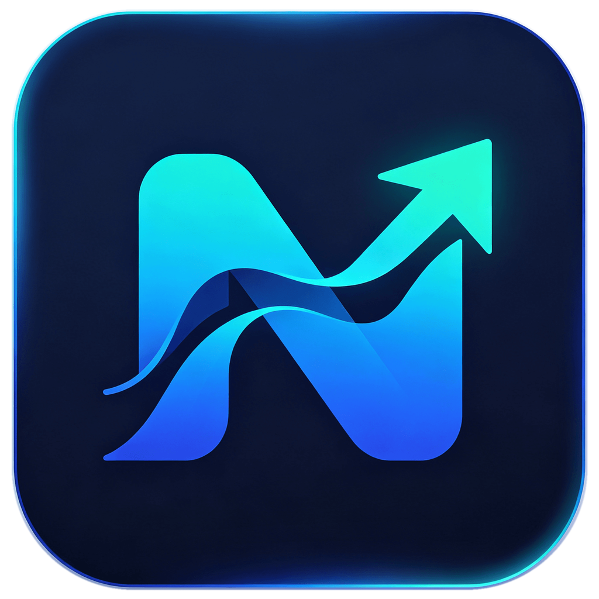
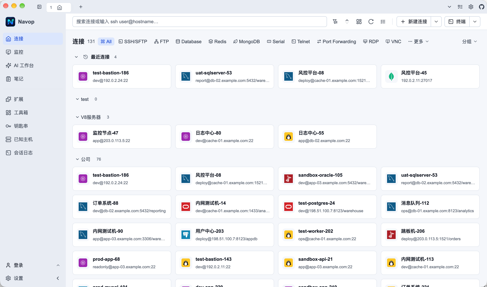
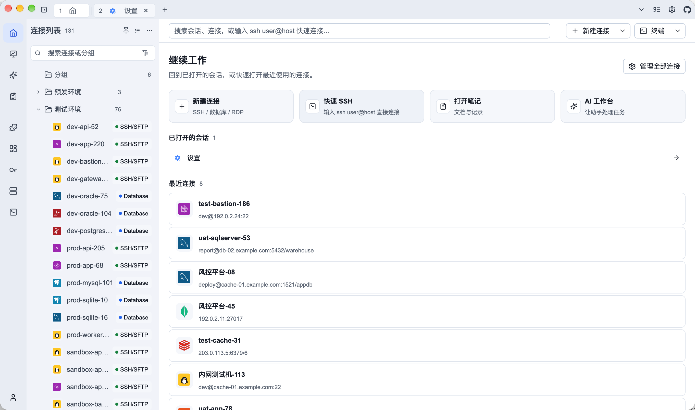
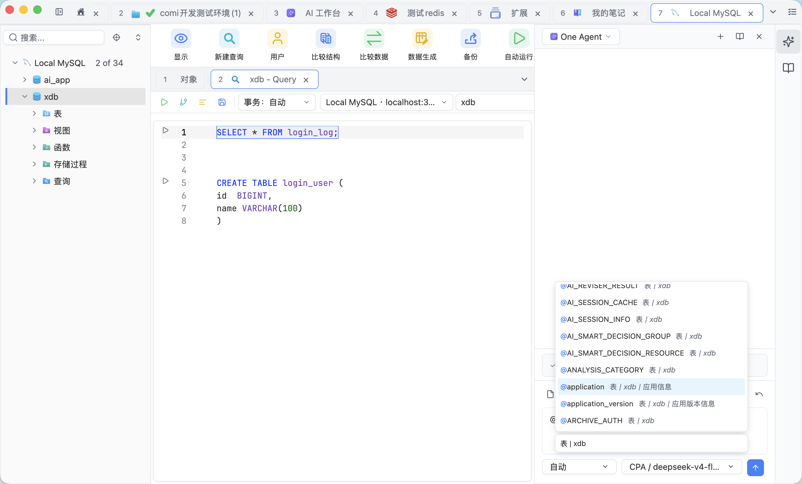
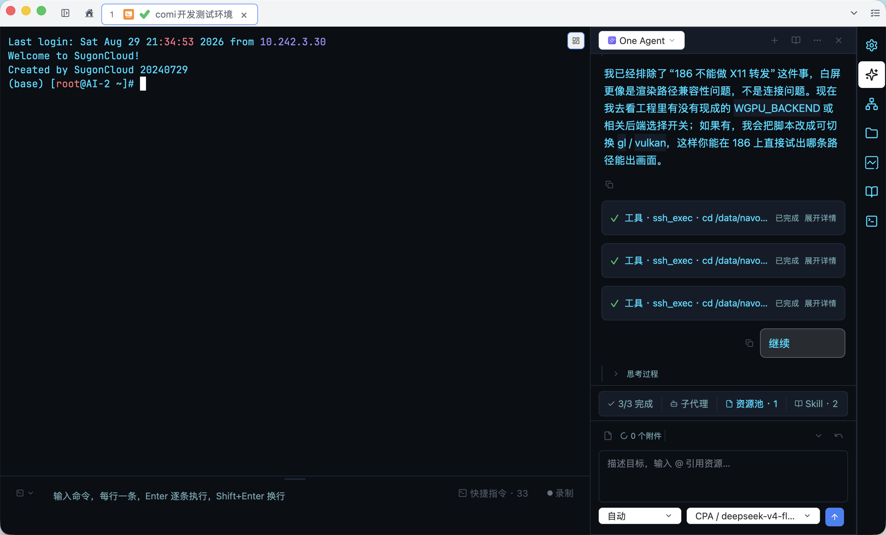
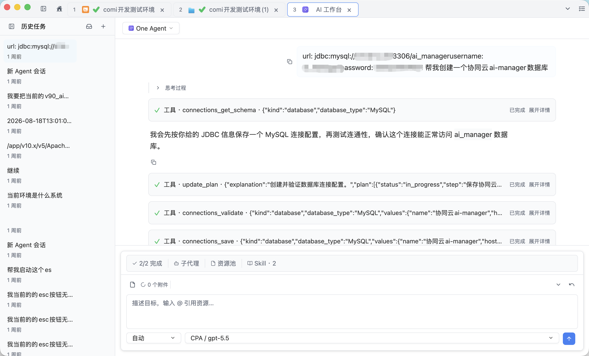
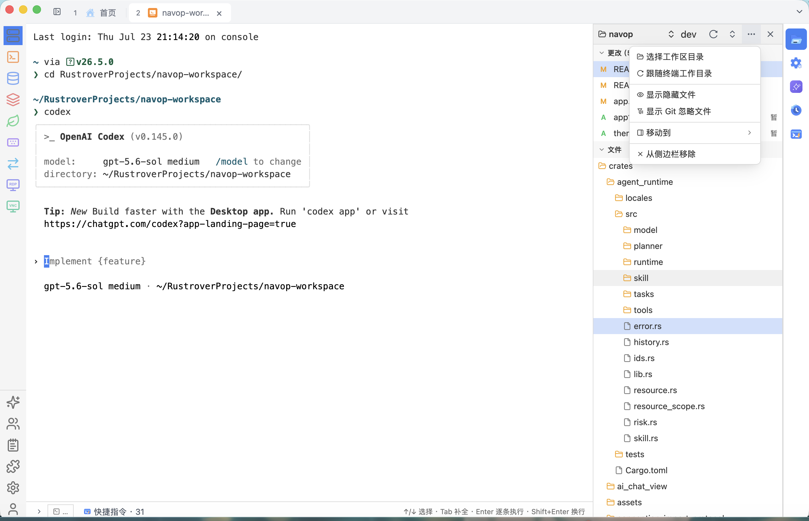
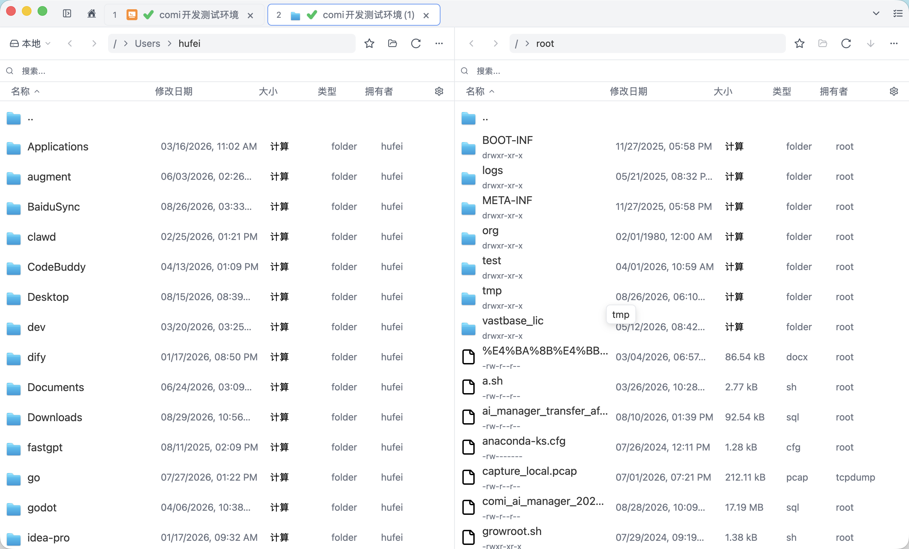
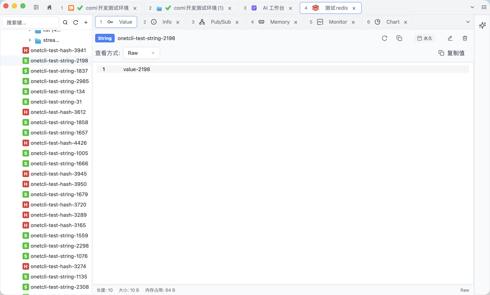

<div align="center">
  <p></p>
  <h1>Navop</h1>
  <p><strong>A native desktop workspace for databases, servers, and AI — written in Rust, rendered with <a href="https://gpui.rs">GPUI</a>.</strong></p>
  <p>Rust + GPUI · GPU-accelerated rendering · No WebView · No Electron</p>

  <p>
    <a href="https://github.com/feigeCode/navop/releases"></a>
    <a href="https://github.com/feigeCode/navop/actions/workflows/ci.yml"></a>
    <a href="#license"></a>
    <a href="https://qm.qq.com/cgi-bin/qm/qr?k=&group_code=860670605"></a>
    <a href="https://docs.qq.com/doc/DVEFFd2RnSnJLcFBD"></a>
  </p>

  <p>
    
    
    
    
    
    
    
    
    
    
    
    
    
    
    
    
    
    
    
    
    
    
    
    
  </p>

  <p>
    <a href="README_CN.md">中文</a> ·
    <a href="https://docs.navop.dev/en-US/">Documentation</a> ·
    <a href="https://navop.dev/en-US/extensions">Download center</a> ·
    <a href="#built-with-rust--gpui">Rust + GPUI</a> ·
    <a href="#what-navop-supports">Capabilities</a> ·
    <a href="#screenshots">Screenshots</a> ·
    <a href="#install">Install</a> ·
    <a href="https://github.com/feigeCode/navop/releases/latest">Latest Release</a> ·
    <a href="CONTRIBUTING.md">Contributing</a>
  </p>

  <p></p>
</div>

## What Navop is

Navop is a native desktop workspace for the work around databases, servers, and AI. Database and Redis/MongoDB clients, SSH/SFTP and terminals, remote desktops, and AI agents share one window instead of separate tools.

It is written in Rust and rendered with [GPUI](https://gpui.rs), the GPU-accelerated UI framework from Zed. There is no WebView, no Electron, and no embedded browser runtime.

## Built with Rust + GPUI

| | |
|:-:|:--|
| **Language** | Rust 2024 for the UI, database drivers, SSH/SFTP stack, terminal emulation, AI runtime, and MCP server |
| **UI** | GPUI with GPU-accelerated layout and painting; large grids, terminals, and charts stay responsive |
| **Runtime** | One self-contained native binary with no embedded browser, Node.js, or web assets |
| **Platforms** | macOS arm64/x64, Windows x64/win32, Linux x64/arm64 |
| **Native integration** | Native menus, shortcuts, file dialogs, tray, keychain, file associations, and auto-update |
| **Extensibility** | WASM component extensions for drivers, renderers, and resource workbenches, loaded without restarting |

Why it is built this way:

- **One language end to end.** Drivers, SSH transport, terminal emulation, and UI share one Rust workspace, so features compose without a browser bridge or a second runtime.
- **GPU rendering instead of DOM layout.** GPUI paints only what changed, keeping multi-pane terminals, wide tables, and charts smooth while several connections are live.
- **No WebView.** Native text rendering, input methods, accessibility, window management, and shortcuts on every platform — in a smaller, self-contained install.

## What Navop supports

- **Databases** — MySQL, PostgreSQL, MariaDB, SQLite, DuckDB, SQL Server, Oracle, ClickHouse, TDengine; Dameng, KingbaseES, GBase, OceanBase, openGauss, IoTDB, and Oscar via extension drivers. SQL editor with plans, import/export, schema and data compare, ER diagrams.
- **Redis, MongoDB, MQTT** — key/value and document browsing plus MQTT pub/sub through an extension.
- **SSH and terminals** — local and remote shells, split panes, quick commands, broadcast input, session recording, and searchable logs.
- **Files and remote access** — SFTP/FTP/FTPS with remote editing, port forwarding, X11, RDP/VNC, Telnet, and serial.
- **AI and automation** — SQL generation and analysis, charts, terminal help, ACP agents (Codex, Claude Code, OpenCode), Agent Hub, and Public MCP.
- **Desktop and teams** — native themes, English/简体中文/繁體中文, encrypted sync, shared connections, extension marketplace, and Markdown notes.

Navop is the complete build. The same source also ships **Navop Shell** (SSH, terminals, port forwarding, remote desktop) and **Navop Data** (SQL, Redis, MongoDB, ER diagrams) as focused editions for narrower installs.

## Public MCP, Navop CLI, and Agent Skill

Navop can expose host-authoritative tools to Codex, Claude, and other MCP clients. Enable **Settings > General > MCP > MCP Server**, choose Safe / Confirm / Auto, and limit exposed tools under **Tool Exposure**. The server binds to a loopback-only port and authenticates clients with a user-only discovery token.

```bash
npm install -g @navop/cli@latest
navop skill install --target codex --scope user
```

`@navop/mcp` is the stdio bridge for native MCP clients (`npx -y @navop/mcp@latest`). See the [Public MCP guide](https://docs.navop.dev/en-US/guide/public-mcp) for client configuration.

## Screenshots

| Workspace |
|:-:|
| [](app1.png) |

| Database | SSH |
|:-:|:-:|
| [](database.png) | [](ssh.png) |

| AI Chat | Agent Hub |
|:-:|:-:|
| [](ai_chat.png) | [](agent_hub.png) |

| SFTP | Redis |
|:-:|:-:|
| [](sftp.png) | [](redis.png) |

## Install

Download Navop from the [download center](https://navop.dev/en-US/extensions), [GitHub Releases](https://github.com/feigeCode/navop/releases), or the [CNB mirror](https://cnb.cool/navop-dev/navop/-/releases). Every asset is also available at `https://navop.pdyyds.cn/releases/<tag>/<file>`, with `sha256sums.txt` for verification.

| Platform | Packages |
|:-:|:-:|
| macOS | `.dmg`, `.tar.gz` (arm64, x64) |
| Windows | `.msi`, `.exe`, `.zip`, `-portable.zip` (x64, win32) |
| Linux | `.tar.gz`, `-portable.tar.gz` (x64, arm64); `.deb`, `.rpm`, `.AppImage` (x64) |

- **macOS:** open the `.dmg` and move `Navop.app` to `/Applications`; if Gatekeeper blocks it, run `sudo xattr -rd com.apple.quarantine /Applications/Navop.app`.
- **Windows:** run the `.msi` or `.exe`; the `.zip` is portable, and `-portable.zip` keeps data beside the executable. Also available via `scoop install navop`.
- **Linux:** run the archive from any directory, or install the `.deb`, `.rpm`, or `.AppImage`.

The same source also builds two smaller editions: **Navop Shell** (SSH, terminals, port forwarding, and remote desktop) and **Navop Data** (SQL, Redis, MongoDB, and ER diagrams). They share Navop's native shell, AI, sync, and extension system and can be installed side by side; most users should start with Navop. Their packages use the `navop-shell-` and `navop-data-` prefixes. See the [install guide](https://docs.navop.dev/en-US/guide/install-update) for the full artifact table and portable-mode details.

## Build from source

Navop uses the Rust 2024 edition and requires platform-specific system dependencies.

```bash
# Linux dependencies
./script/bootstrap

# Run the application
cargo run -p navop
```

On Windows, install dependencies from PowerShell with:

```powershell
.\script\install-window.ps1
```

Common development checks:

```bash
cargo build
cargo test --all
cargo clippy --workspace --all-targets
cargo fmt --check
```

See [CONTRIBUTING.md](CONTRIBUTING.md) for the complete development guide.

## Community and support

Navop is maintained independently. Stars, focused pull requests, and bug reports all help sustain the project.

- [Report a bug or request a feature](https://github.com/feigeCode/navop/issues)
- QQ Group: [860670605](https://qm.qq.com/cgi-bin/qm/qr?k=&group_code=860670605)
- WeChat Group: [Join](https://docs.qq.com/doc/DVEFFd2RnSnJLcFBD)
- Legacy OnetCli repository: [feigeCode/onetcli](https://github.com/feigeCode/onetcli)

## Star History

<a href="https://star-history.dera.page/#feigeCode/navop&type=date&logscale=&legend=top-left">
  <picture>
    <source media="(prefers-color-scheme: dark)" srcset="https://star-history.dera.page/svg?repos=feigeCode/navop&type=date&theme=dark&logscale&legend=top-left" />
    <source media="(prefers-color-scheme: light)" srcset="https://star-history.dera.page/svg?repos=feigeCode/navop&type=date&logscale&legend=top-left" />
    
  </picture>
</a>

## Credits

ER diagram rendering is based on [ferrum-flow](https://github.com/tu6ge/ferrum-flow.git).

## License

Navop source code is licensed under [Apache License 2.0](LICENSE-APACHE). Navop-authored portions are additionally subject to the [Navop Supplementary License](NAVOP_LICENSE), which permits free redistribution through free distribution channels (such as GitHub Releases, Flatpak repositories, and free app stores) while prohibiting commercial resale, charging fees, competing products or services, and paid distribution platforms. Third-party components remain subject to their own licenses.

For licensing inquiries, contact xiaofei.hf@gmail.com.
