<div align="center">
  <p>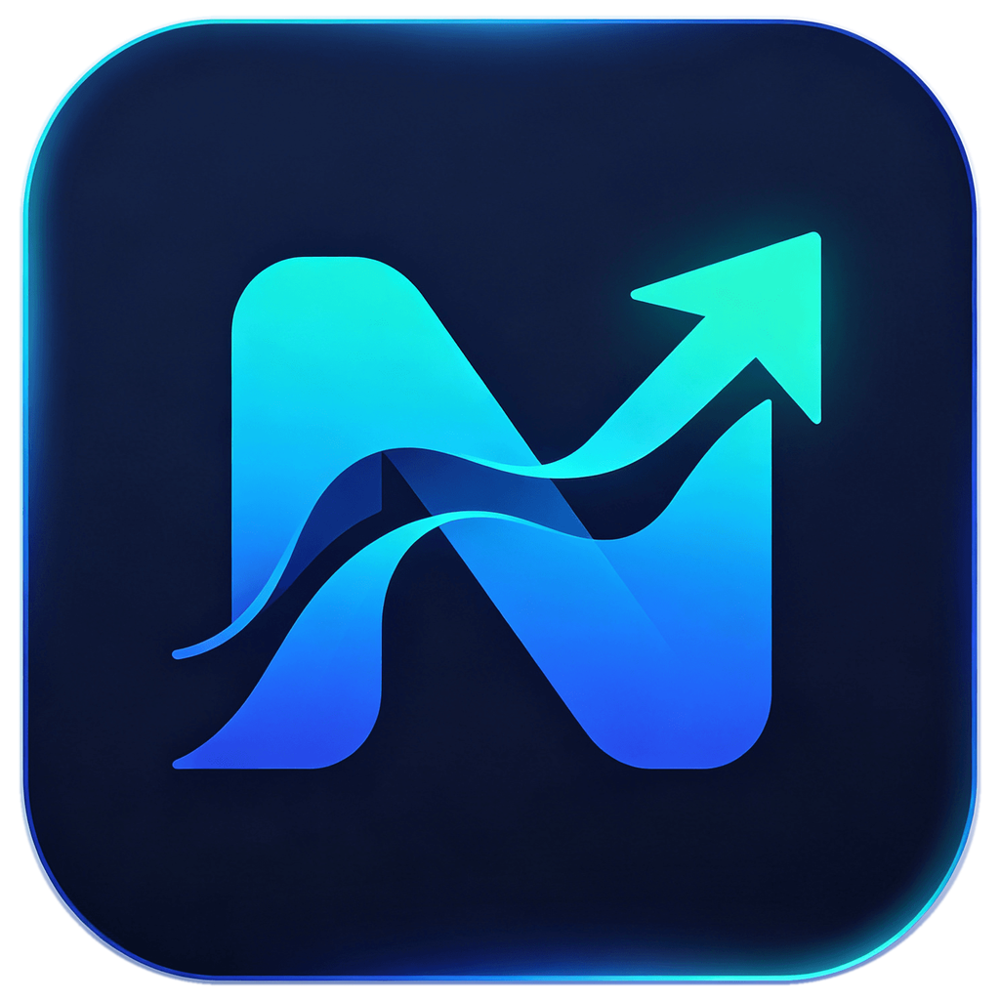</p>
  <h1>Navop</h1>
  <p><strong>One native core, three applications: Navop for everything, Navop Shell for remote operations, and Navop Data for data work.</strong></p>
  <p>Built with <a href="https://gpui.rs">GPUI</a> and Rust · GPU-accelerated rendering · No WebView</p>

  <p>
    <a href="https://github.com/feigeCode/navop/releases"></a>
    <a href="https://github.com/feigeCode/navop/actions/workflows/ci.yml"></a>
    <a href="#license"></a>
    <a href="https://qm.qq.com/cgi-bin/qm/qr?k=&group_code=860670605"></a>
    <a href="https://docs.qq.com/doc/DVEFFd2RnSnJLcFBD"></a>
  </p>

  <p>
    
    
    
    
    
    
    
    
    
    
    
    
    
    
    
    
    
    
    
    
    
    
    
    
  </p>

  <p>
    <a href="README_CN.md">中文</a> ·
    <a href="https://docs.navop.dev/en-US/">Documentation</a> ·
    <a href="https://navop.dev/en-US/extensions">Download center</a> ·
    <a href="#the-product-family">Product family</a> ·
    <a href="#features">Features</a> ·
    <a href="#screenshots">Screenshots</a> ·
    <a href="#install">Install</a> ·
    <a href="https://github.com/feigeCode/navop/releases/latest">Latest Release</a> ·
    <a href="CONTRIBUTING.md">Contributing</a>
  </p>

  <p>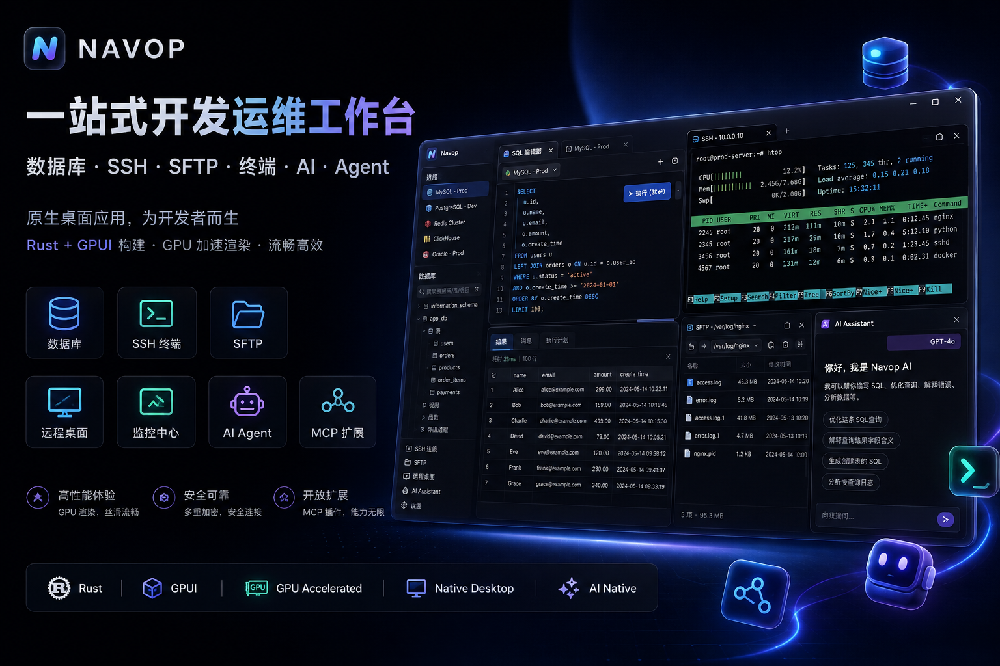</p>
</div>

## The product family

Navop ships as three applications built on the same native core and released together under the same version number.

| Application | What it's for | Domain capabilities | Platforms | Package prefix | Download |
|:-:|:-:|:-:|:-:|:-:|:-:|
| **Navop** (all-in-one) | Everything in one workspace | PostgreSQL, MySQL, MariaDB, SQLite, SQL Server, Oracle, ClickHouse, Dameng DM, KingbaseES, OceanBase, openGauss and more; Redis; MongoDB; SSH/SFTP; local and remote terminals; port forwarding; RDP/VNC remote desktop; serial/Telnet; SQL editor; ER diagrams; data migration; monitoring; Notes; AI workbench; team sync; extension marketplace; Public MCP | macOS arm64/x64, Windows x64/win32, Linux x64/arm64 | `navop-<version>-<label>.<ext>` | [Download center](https://navop.dev/en-US/extensions) · [GitHub](https://github.com/feigeCode/navop/releases) · [CNB](https://cnb.cool/navop-dev/navop/-/releases) |
| **Navop Shell** (remote operations) | SSH, terminals, and remote desktop without the database tooling | SSH/SFTP; local and remote terminals; port forwarding; RDP/VNC remote desktop; serial/Telnet | macOS arm64/x64, Windows x64, Linux x64 | `navop-shell-<version>-<label>.<ext>` | [Download center](https://navop.dev/en-US/extensions) · [GitHub](https://github.com/feigeCode/navop/releases) · [CNB](https://cnb.cool/navop-dev/navop/-/releases) |
| **Navop Data** (data tools) | Database work without the remote-operations tooling | SQL workspace; Redis; MongoDB; ER diagrams; data migration | macOS arm64/x64, Windows x64, Linux x64 | `navop-data-<version>-<label>.<ext>` | [Download center](https://navop.dev/en-US/extensions) · [GitHub](https://github.com/feigeCode/navop/releases) · [CNB](https://cnb.cool/navop-dev/navop/-/releases) |

All three share the AI workbench, Notes, team sync, the extension marketplace, themes, shortcuts, tab restore, tray behavior, single-instance handling, auto-update, and Public MCP. They are released at the same version, can be installed side by side, and keep separate data directories and keychain entries. Only the all-in-one Navop registers the `.db`, `.duckdb`, `.md`, and `.cast` file associations.

## Features

### Databases and data tools — Navop / Navop Data

- Built-in support for MySQL, PostgreSQL, SQLite, DuckDB, SQL Server, and Oracle; ClickHouse and TDengine are provided as installable extension drivers, alongside Dameng DM, KingbaseES, GBase 8s, OceanBase, openGauss, Apache IoTDB, and Oscar.
- Browse database objects, edit and run SQL with execution plans, import and export data, compare schemas and data, and visualize relationships with ER diagrams.
- Dedicated Redis and MongoDB interfaces; middleware connections such as MQTT are provided through installable extensions (MQTT 3.1.1 over rustls, SSH tunneling, auto-resubscribe), with subscribe, messages, and publish views.
- Table-data tabs support batch-editing selected cells, typed editors for date/time/numeric columns, and copying table or column names from context menus.

### Remote access and operations — Navop / Navop Shell

- SSH and local terminals with draggable split panes, quick commands, broadcast input, shell integration, session lock, recording and replay, searchable session logs with batch delete and incremental loading; Telnet and serial connections are also supported.
- Manage remote files with SFTP, FTP, and FTPS: uploads, downloads, search, favorites, remote editing (configurable size limits and default editor), drag-and-drop, ZMODEM transfer, and server-to-server copy. Create standalone FTP/FTPS connections, or switch the remote-file protocol on an SSH connection while its terminal keeps using SSH; an open-mode preference decides whether a double-click opens the terminal or the dual-pane file view.
- Reusable local, remote (`ssh -R`), and dynamic SOCKS port forwarding; X11 forwarding; host-key change warnings with explicit fingerprints; a Known Hosts page for reviewing, importing, and removing trusted SSH host keys; optional legacy SSH algorithms.
- Import SecureCRT sessions, monitor servers with native charts, and connect to remote desktops over RDP and VNC. On Windows, native MSTSC integration embeds the Microsoft RDP ActiveX control directly in the app via a C++ host, so you can use it inside a tab, in a fullscreen window, or launch the native `mstsc.exe` client; across platforms a pure-Rust IronRDP canvas backend renders RDP sessions.

### Editing, AI, and extensibility — shared by all three

- Local Markdown notes with Mermaid diagrams, math rendering, and export to HTML, PDF, or DOCX; the built-in editor supports save shortcuts and WASM language parsers for syntax highlighting.
- AI for SQL generation and explanation, data analysis, charts, terminal assistance, tool calling, and agent workflows; connect external agents through ACP for Codex, Claude Code, and OpenCode.
- Agent Hub keeps a terminal agent, project files, Git branches, changes, and side-by-side diffs in one workspace; the toolbox aggregates extension tools alongside connection extensions.
- The extension marketplace adds database drivers, remote desktop providers, document renderers, connection importers, external editors, and native resource workbenches rendered by the host (starting with a Docker workbench for containers, images, logs, processes, and exec terminals). First-party extensions are built and published from the [navop-extensions](https://github.com/feigeCode/navop-extensions) repository.
- Quick open supports ad-hoc SSH connections from the tab bar, so throwaway sessions no longer need a saved connection.

### Native desktop experience — shared by all three

- Native GPUI interface with GPU-accelerated rendering; light, dark, and system themes, importable themes, accent colors, and window opacity.
- Home page with a unified grid layout, tree view, recent connections, batch connection management, and workspace drag-order persistence.
- Settings organized into dedicated database, terminal, Agent, and MCP pages; shortcuts can be cleared and system-wide hotkeys disabled.
- English, Simplified Chinese, and Traditional Chinese interfaces.
- Encrypted synchronization of personal connections, credentials, and settings across devices by Navop Cloud Sync or Personal Sync(Folder / Git / WebDAV).

## Public MCP, Navop CLI, and Agent Skill

Navop can expose selected host-authoritative tools to external Codex, Claude, MCP clients, and automation. Enable the server under **Settings > General > MCP > MCP Server**, choose a permission profile (Safe / Confirm / Auto), and select the required groups under **Tool Exposure**. The runtime listens on a dynamic loopback-only port and authenticates clients with a user-only discovery token; Navop remains authoritative for live tools, schemas, permissions, approvals, and audit records.

For terminal-capable agents, install the [`@navop/cli`](https://github.com/feigeCode/navop-mcp) package and the bundled Navop Skill:

```bash
npm install -g @navop/cli@latest

# Install the Skill for Codex, or use --target agents for Agents-compatible clients
navop skill install --target codex --scope user
```

Each application runs its own MCP server and is discovered and authorized separately, as `navop`, `navop-shell`, or `navop-data`; the CLI and Skill workflow is identical for all three. Agent Skill installation and CLI commands do not change.

The separate [`@navop/mcp`](https://github.com/feigeCode/navop-mcp) package is only the stdio bridge for native MCP clients (`npx -y @navop/mcp@latest`). See the [Navop MCP and CLI repository](https://github.com/feigeCode/navop-mcp) and the [Public MCP guide](https://docs.navop.dev/en-US/guide/public-mcp) for the full command reference and client configuration.

## Screenshots

| Workspace |
|:-:|
| [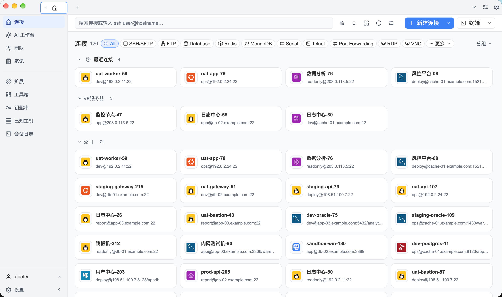](app1.png) |

| Database | SSH |
|:-:|:-:|
| [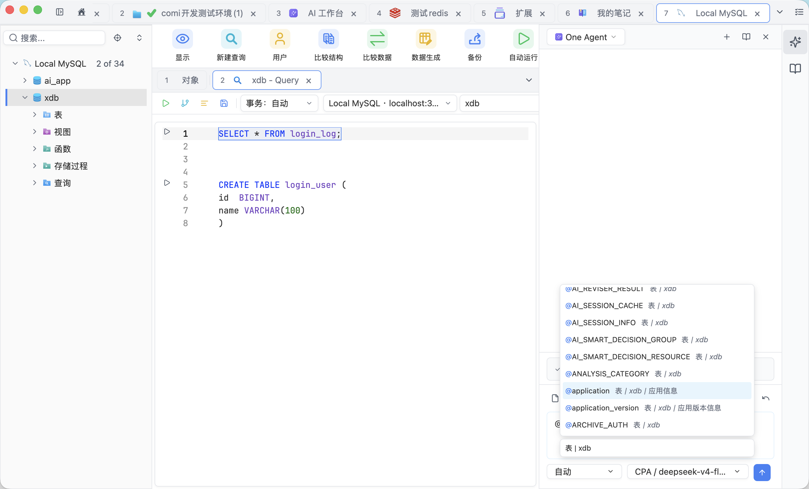](database.png) | [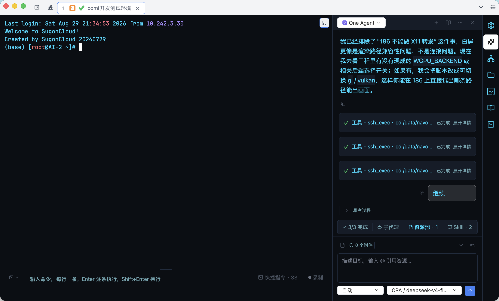](ssh.png) |

| SFTP | Redis |
|:-:|:-:|
| [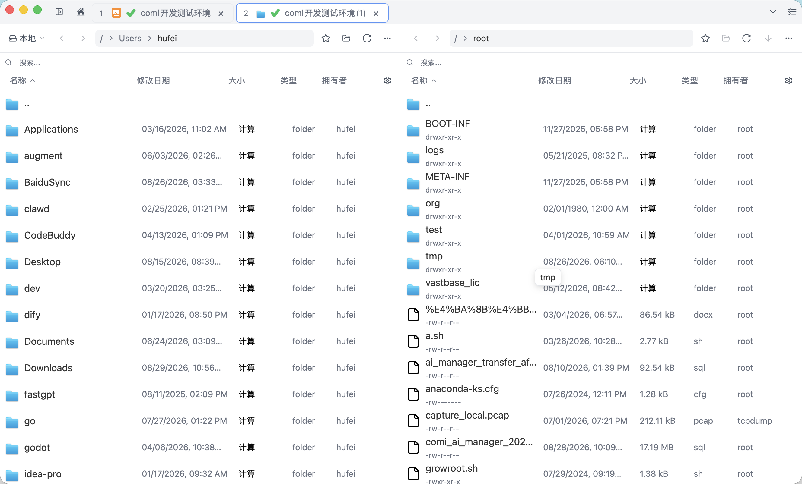](sftp.png) | [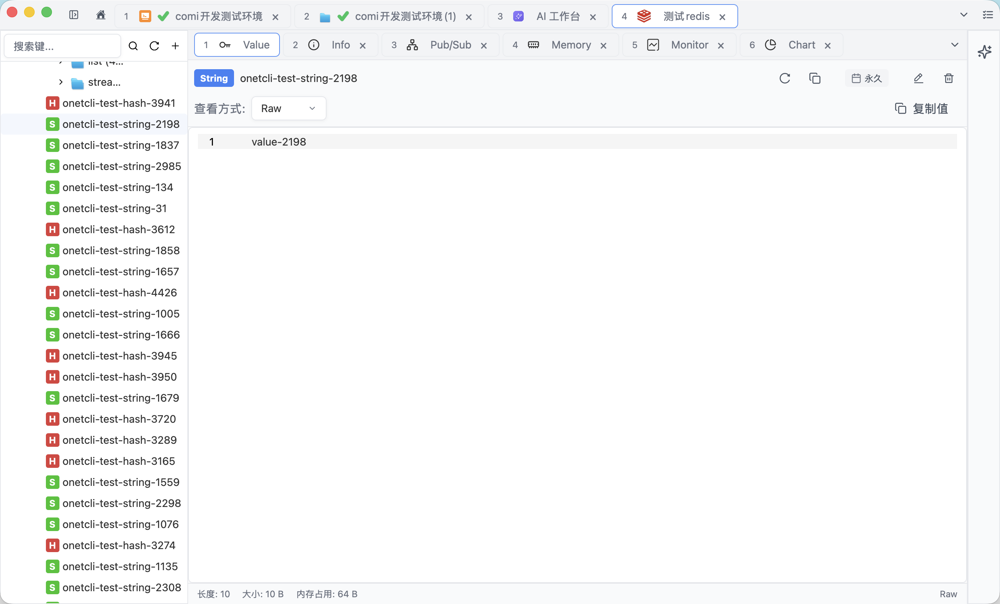](redis.png) |

| MongoDB |                AI Chat                |
|:-:|:-------------------------------------:|
| [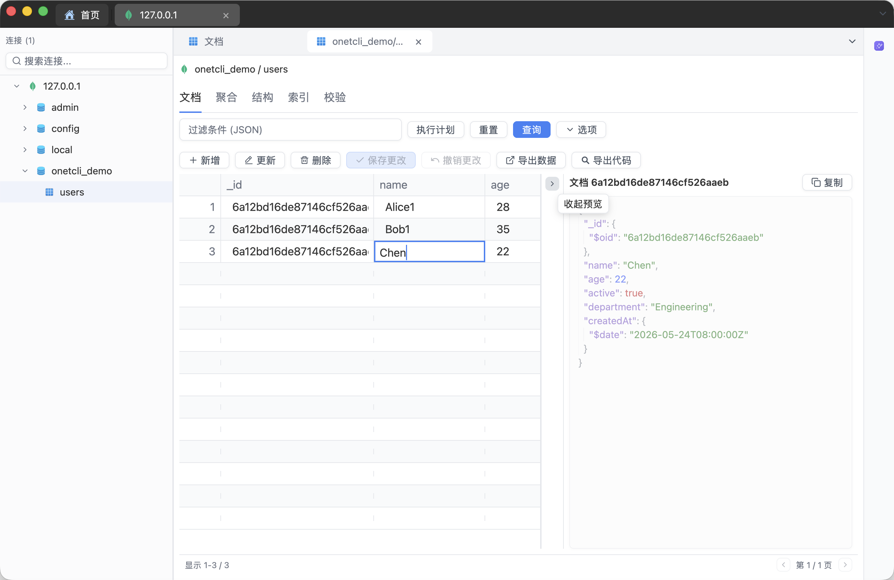](mongodb.png) | [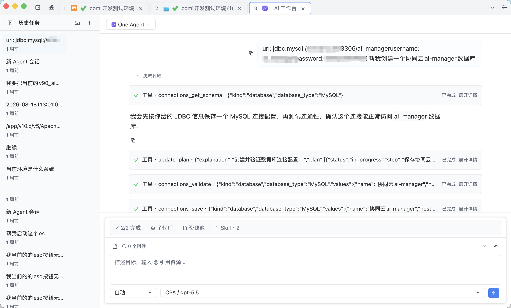](ai_chat.png) |

| Agent Hub | Extensions |
|:-:|:-:|
| [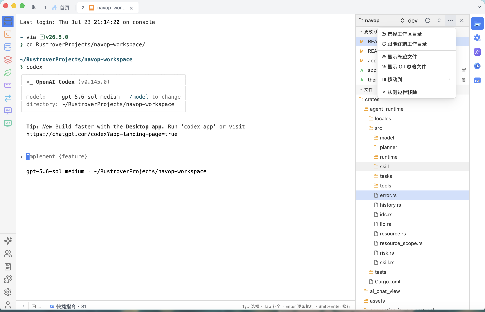](agent_hub.png) | [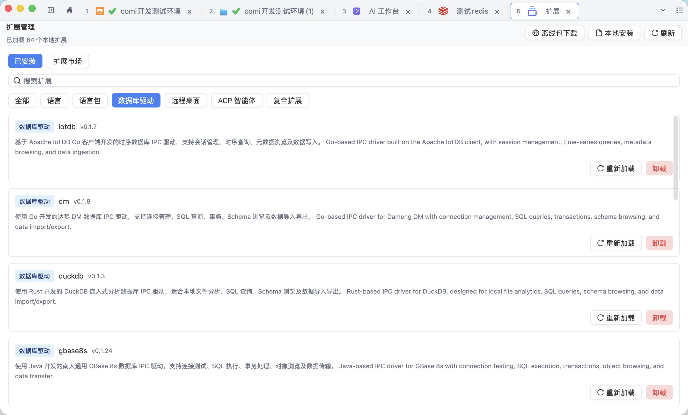](extension.png) |

| Remote File Editor | ER Diagram |
|:-:|:-:|
| [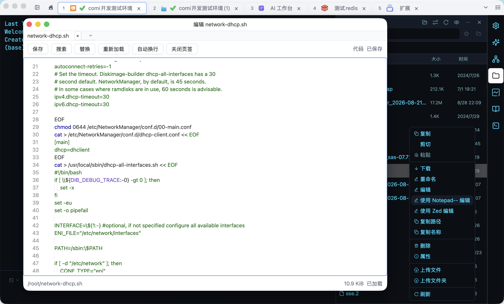](remote_file_editor.png) | [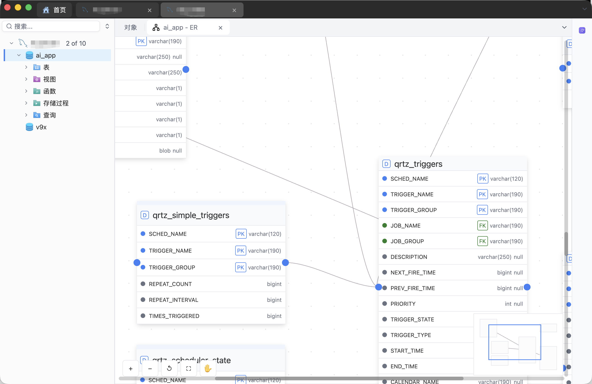](er.png) |

| Monitoring | Themes |
|:-:|:-:|
| [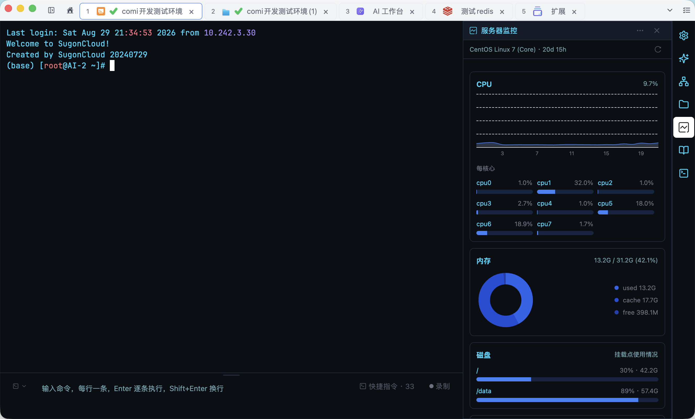](monitor.png) | [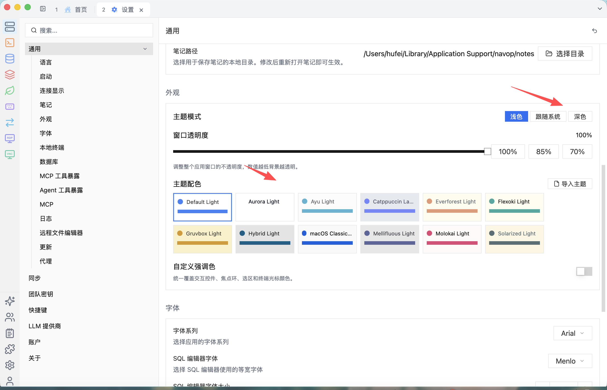](theme.png) |

## Install

Navop, Navop Shell, and Navop Data are built from the same source and released together under the same version number. Download them from the [download center](https://navop.dev/en-US/extensions), [GitHub Releases](https://github.com/feigeCode/navop/releases), or the [CNB mirror](https://cnb.cool/navop-dev/navop/-/releases). Every asset is also available from the R2 mirror at `https://navop.pdyyds.cn/releases/<tag>/<file>`, substituting the release tag and asset name.

### Packages and platforms

Package names follow `<product>-<version>-<label>.<ext>`:

- `navop-<version>-<label>.<ext>` — the all-in-one Navop
- `navop-shell-<version>-<label>.<ext>` — Navop Shell
- `navop-data-<version>-<label>.<ext>` — Navop Data

Supported labels are `macos-arm64`, `macos-x64`, `windows-x64`, and `linux-x64`. The all-in-one Navop additionally ships `win32` and `linux-arm64`.

| Product | macOS | Windows | Linux |
|:-:|:-:|:-:|:-:|
| Navop | `.dmg`, `.tar.gz` (arm64, x64) | `.msi`, `.exe`, `.zip`, `-portable.zip` (x64, win32) | `.tar.gz`, `-portable.tar.gz` (x64, arm64); `.deb`, `.rpm`, `.AppImage`, `-gpu-stack.tar.gz` (x64) |
| Navop Shell | `.dmg`, `.tar.gz` (arm64, x64) | `.msi`, `.exe`, `.zip`, `-portable.zip` (x64) | `.tar.gz`, `-portable.tar.gz` (x64) |
| Navop Data | `.dmg`, `.tar.gz` (arm64, x64) | `.msi`, `.exe`, `.zip`, `-portable.zip` (x64) | `.tar.gz`, `-portable.tar.gz` (x64) |

The standalone applications do not ship `win32`, `linux-arm64`, `.deb`/`.rpm`/`.AppImage`, or the GPU dependency bundle. Every release includes `sha256sums.txt` for checksum verification.

### macOS

Open the `.dmg` or unpack the `.tar.gz`, then move the application to `/Applications` — `Navop.app`, `Navop Shell.app`, or `Navop Data.app`. If Gatekeeper reports that Apple cannot check the app, clear the quarantine flag for the product you installed:

```bash
sudo xattr -rd com.apple.quarantine /Applications/Navop.app
sudo xattr -rd com.apple.quarantine "/Applications/Navop Shell.app"
sudo xattr -rd com.apple.quarantine "/Applications/Navop Data.app"
```

### Windows

Run the `.msi` or `.exe` installer. The `.zip` is a standard archive build; `-portable.zip` keeps data inside the installation directory. The all-in-one Navop is also available through [Scoop](https://scoop.sh) (portable edition, with data persistence handled by Scoop):

```powershell
scoop bucket add extras
scoop install navop
```

Scoop only packages the all-in-one Navop; get Navop Shell and Navop Data from the download center, GitHub Releases, or CNB.

### Linux

The `.tar.gz` archives run from any directory, and `-portable.tar.gz` stores data next to the executable. On linux-x64, the all-in-one Navop additionally ships `.deb`, `.rpm`, and `.AppImage` packages plus a `-gpu-stack.tar.gz` bundle that carries the GPU dependencies; Navop Shell and Navop Data ship `.tar.gz` and `-portable.tar.gz` only.

The all-in-one Navop is also available from [FlatPark](https://flatpark.org/apps/dev.navop.Navop/) as a community Flatpak package:

```bash
flatpak --user remote-add --if-not-exists flatpark https://dl.flatpark.org/flatpark.flatpakrepo
flatpak --user install flatpark dev.navop.Navop
```

### Updates and data locations

Each product has its own update manifest:

- Navop — `https://navop.pdyyds.cn/updates/latest.json`
- Navop Shell — `https://navop.pdyyds.cn/updates/navop-shell/shell/latest.json`
- Navop Data — `https://navop.pdyyds.cn/updates/navop-data/data/latest.json`

Configuration, application data, and keychain entries are also kept separate. Configuration lives in `~/.config/<product>` on macOS and Linux and in `%APPDATA%\<product>` on Windows, where `<product>` is `navop`, `navop-shell`, or `navop-data`. Application data lives in `~/Library/Application Support/<product>` on macOS, `~/.local/share/<product>` on Linux, and `%APPDATA%\<product>` on Windows. Credentials use a per-product keychain service: `com.navop.desktop`, `com.navop.shell`, or `com.navop.data`. Portable builds keep data in `<install directory>/data` and are marked by `navop.portable`, `navop-shell.portable`, or `navop-data.portable`.

For the complete artifact table, Windows portable-mode notes, upgrade migration from v0.10.1 or earlier ZIPs, and the Oracle Instant Client / pure-Go driver note, see the [Install & update guide](https://docs.navop.dev/en-US/guide/install-update).

## Build from source

Navop uses the Rust 2024 edition and requires platform-specific system dependencies.

```bash
# Linux dependencies
./script/bootstrap

# Run the all-in-one application
cargo run -p navop

# Run the standalone applications
cargo run -p navop-shell
cargo run -p navop-data
```

On Windows, install dependencies from PowerShell with:

```powershell
.\script\install-window.ps1
```

Common development checks:

```bash
cargo build
cargo test --all
cargo clippy --workspace --all-targets
cargo fmt --check
```

See [CONTRIBUTING.md](CONTRIBUTING.md) for the complete development guide.

## Community and support

Navop is maintained independently. Stars, focused pull requests, and bug reports all help sustain the project.

- [Report a bug or request a feature](https://github.com/feigeCode/navop/issues)
- QQ Group: [860670605](https://qm.qq.com/cgi-bin/qm/qr?k=&group_code=860670605)
- WeChat Group: [Join](https://docs.qq.com/doc/DVEFFd2RnSnJLcFBD)
- Legacy OnetCli repository: [feigeCode/onetcli](https://github.com/feigeCode/onetcli)

## Star History

<a href="https://star-history.dera.page/#feigeCode/navop&type=date&logscale=&legend=top-left">
  <picture>
    <source media="(prefers-color-scheme: dark)" srcset="https://star-history.dera.page/svg?repos=feigeCode/navop&type=date&theme=dark&logscale&legend=top-left" />
    <source media="(prefers-color-scheme: light)" srcset="https://star-history.dera.page/svg?repos=feigeCode/navop&type=date&logscale&legend=top-left" />
    
  </picture>
</a>

## Credits

ER diagram rendering is based on [ferrum-flow](https://github.com/tu6ge/ferrum-flow.git).

## License

Navop source code is licensed under [Apache License 2.0](LICENSE-APACHE). Navop-authored portions are additionally subject to the [Navop Supplementary License](NAVOP_LICENSE), which permits free redistribution through free distribution channels (such as GitHub Releases, Flatpak repositories, and free app stores) while prohibiting commercial resale, charging fees, competing products or services, and paid distribution platforms. Third-party components remain subject to their own licenses.

For licensing inquiries, contact xiaofei.hf@gmail.com.
