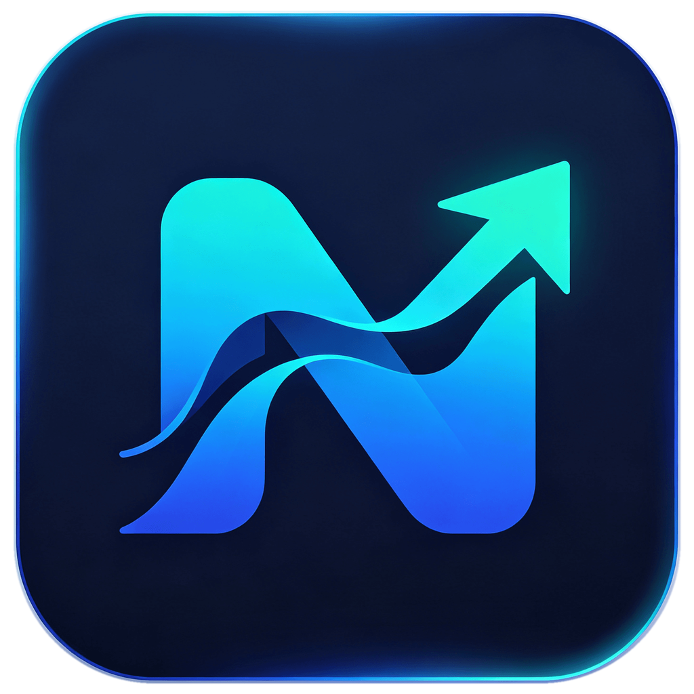
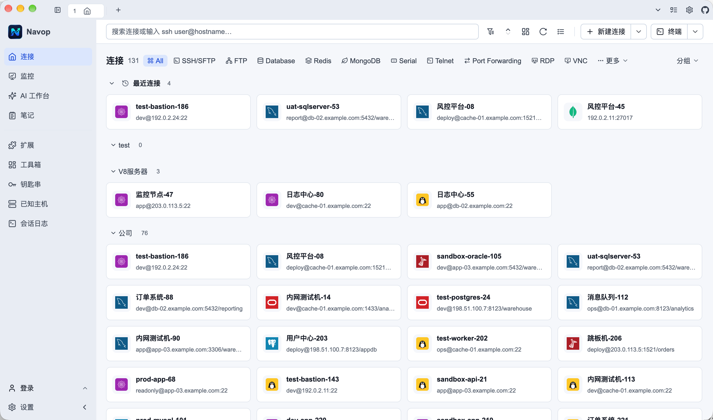
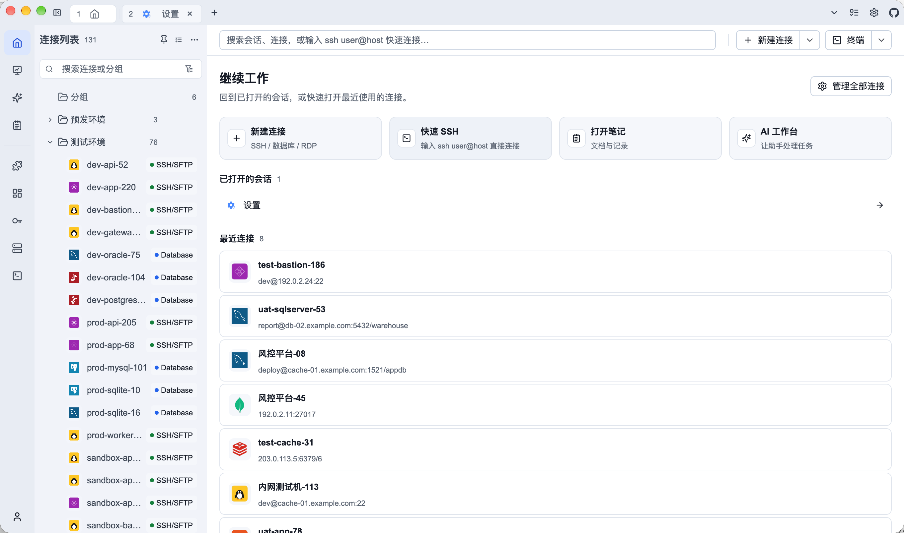
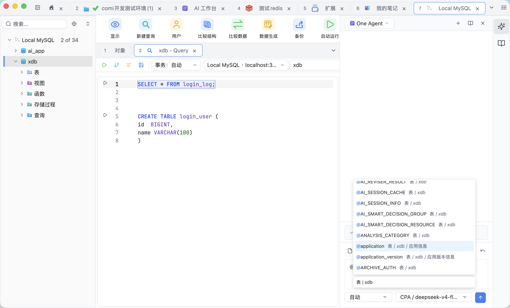
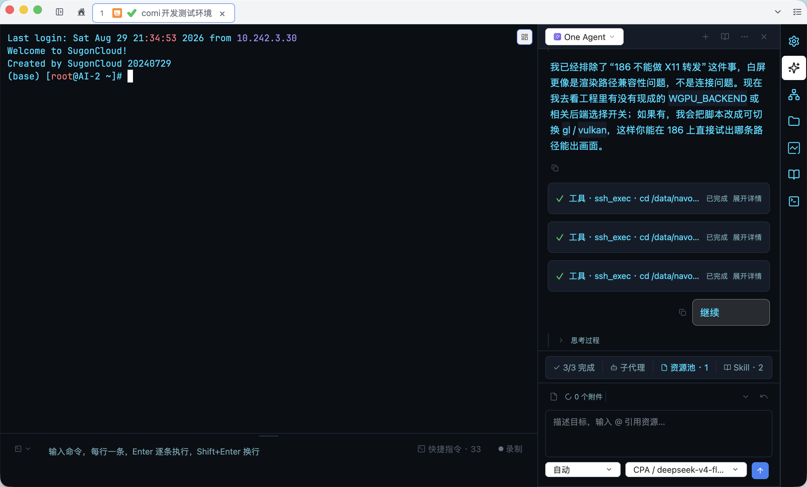
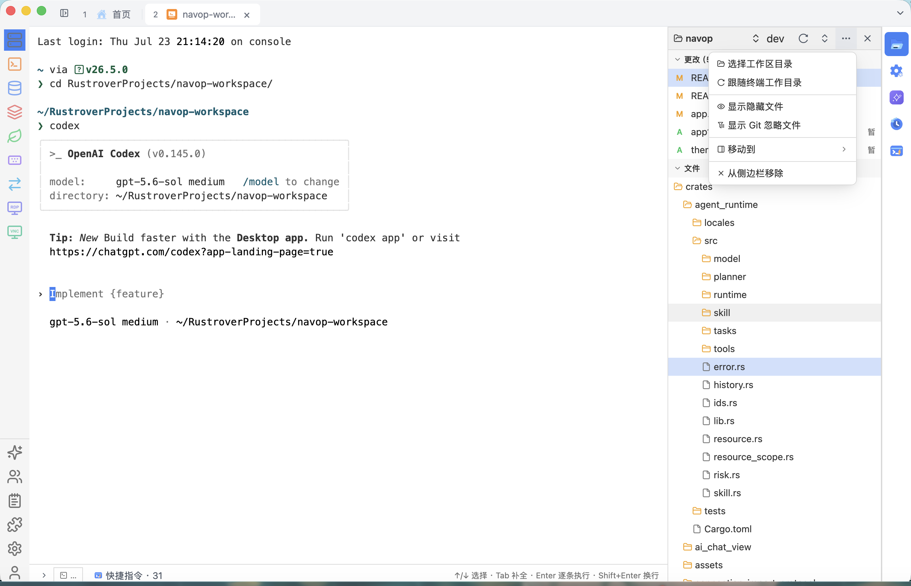
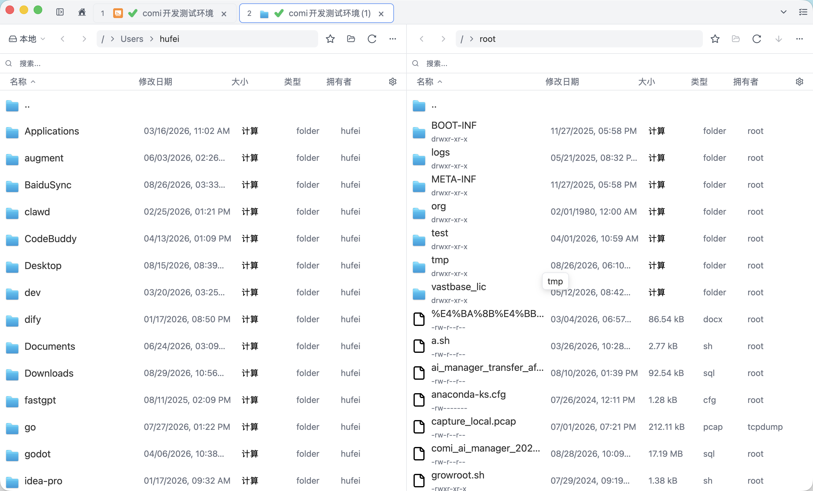
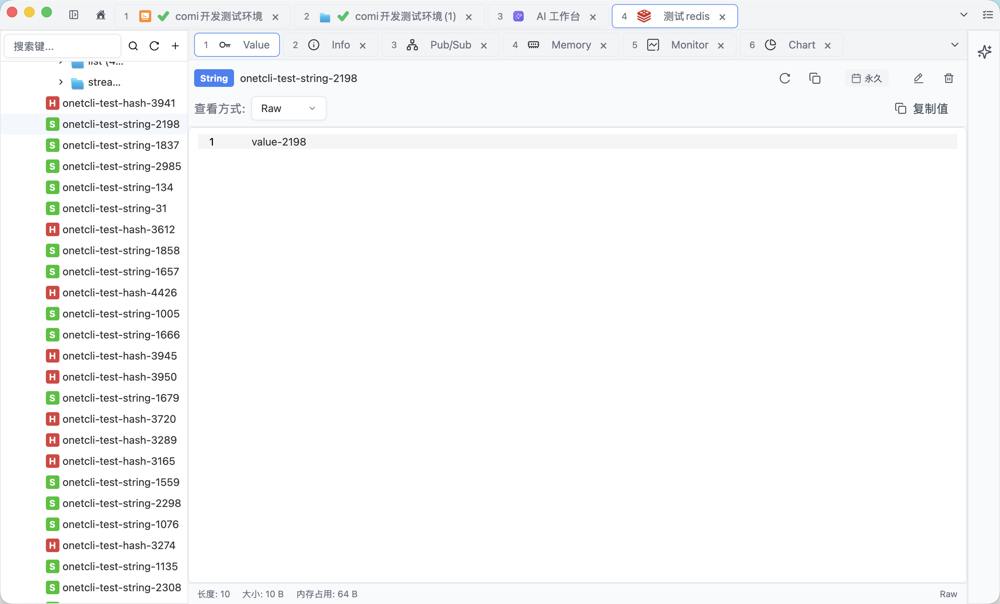

<div align="center">
  <p></p>
  <h1>Navop</h1>
  <p><strong>面向数据库、服务器与 AI 的原生桌面工作台 —— Rust 编写，<a href="https://gpui.rs">GPUI</a> 渲染。</strong></p>
  <p>Rust + GPUI · GPU 加速渲染 · 无 WebView · 无 Electron</p>

  <p>
    <a href="https://github.com/feigeCode/navop/releases"></a>
    <a href="https://github.com/feigeCode/navop/actions/workflows/ci.yml"></a>
    <a href="#许可证"></a>
    <a href="https://qm.qq.com/cgi-bin/qm/qr?k=&group_code=860670605"></a>
    <a href="https://docs.qq.com/doc/DVEFFd2RnSnJLcFBD"></a>
  </p>

  <p>
    
    
    
    
    
    
    
    
    
    
    
    
    
    
    
    
    
    
    
    
    
    
    
    
  </p>

  <p>
    <a href="README.md">English</a> ·
    <a href="https://docs.navop.dev/">使用文档</a> ·
    <a href="https://navop.dev/zh-CN/extensions">下载中心</a> ·
    <a href="#基于-rust--gpui-构建">Rust + GPUI</a> ·
    <a href="#navop-支持什么">能力</a> ·
    <a href="#应用截图">应用截图</a> ·
    <a href="#安装">安装</a> ·
    <a href="https://github.com/feigeCode/navop/releases/latest">最新版本</a> ·
    <a href="CONTRIBUTING.md">参与贡献</a>
  </p>

  <p></p>
</div>

## 赞助商

<p align="center">
  <a href="https://www.infistar.cc/register?aff=TKUN9HBM&amp;ref_source=link">
    
  </a>
</p>

Navop × Infistar.cc 无限星河｜一个 API Key，把 Claude、GPT、Gemini、Grok、DeepSeek 等模型接入 Navop，用于 SQL 生成和 AI 对话。低至官方 0.1 折，省 99%；官方渠道，每个模型都能验真。200+ 模型、16 个品牌；上千线路安全冗余自动切换。[通过 Navop 专属链接注册，领取人民币 5 元体验额度](https://www.infistar.cc/register?aff=TKUN9HBM&ref_source=link)。

## Navop 是什么

Navop 是一个面向数据库、服务器与 AI 的原生桌面工作台。数据库与 Redis/MongoDB 客户端、SSH/SFTP 与终端、远程桌面和 AI Agent 共用一个窗口，不必在多个工具之间切换。

它用 Rust 编写，由 [GPUI](https://gpui.rs)（Zed 的 GPU 加速 UI 框架）直接渲染：没有 WebView，没有 Electron，也没有内嵌浏览器运行时。

## 基于 Rust + GPUI 构建

| | |
|:-:|:--|
| **语言** | Rust 2024，覆盖界面、数据库驱动、SSH/SFTP、终端模拟、AI 运行时与 MCP 服务 |
| **界面** | GPUI 负责布局与绘制，由 GPU 加速；大结果集、终端分屏和图表保持流畅 |
| **运行时** | 单一原生二进制，不内嵌浏览器、Node.js 或 Web 资源 |
| **平台** | macOS arm64/x64、Windows x64/win32、Linux x64/arm64 |
| **原生集成** | 原生菜单、快捷键、文件对话框、托盘、钥匙串、文件关联与自动更新 |
| **扩展** | WASM 组件扩展驱动、渲染器与资源工作台，安装后无需重启 |

为什么这样构建：

- **从头到尾一种语言。** 驱动、SSH 传输、终端模拟和界面共享同一套 Rust 工作区，能力可以组合，不需要浏览器桥接或第二套运行时。
- **GPU 绘制，而不是 DOM 布局。** GPUI 只重绘变化的部分，多连接并行时，终端分屏、宽表格和图表依然顺滑。
- **没有 WebView。** 原生文本渲染、输入法、辅助功能、窗口管理与快捷键在各平台保持一致，安装包也更小。

## Navop 支持什么

- **数据库** —— MySQL、PostgreSQL、MariaDB、SQLite、DuckDB、SQL Server、Oracle、ClickHouse、TDengine；达梦、金仓、GBase、OceanBase、openGauss、IoTDB、Oscar 通过扩展驱动接入。SQL 编辑器、执行计划、导入导出、结构与数据比较、ER 图。
- **Redis / MongoDB / MQTT** —— Key 与文档浏览，以及通过扩展提供的 MQTT 订阅与发布。
- **SSH 与终端** —— 本地/远程终端、分屏、快捷命令、广播输入、会话录制与可搜索日志。
- **文件与远程访问** —— SFTP/FTP/FTPS 与远程编辑、端口转发、X11、RDP/VNC、Telnet、串口。
- **AI 与自动化** —— SQL 生成与分析、图表、终端协助、ACP Agent（Codex、Claude Code、OpenCode）、Agent Hub 与 Public MCP。
- **桌面与团队** —— 原生主题、English/简体中文/繁體中文、加密同步、共享连接、扩展市场与 Markdown 笔记。

Navop 是完整版本。同一份源码还会构建 **Navop Shell**（SSH、终端、端口转发、远程桌面）和 **Navop Data**（SQL、Redis、MongoDB、ER 图）两个范围更小的版本，适合只需要其中一部分能力的安装场景。

## Public MCP、Navop CLI 与 Agent Skill

Navop 可以把宿主侧的工具开放给 Codex、Claude 和其他 MCP 客户端。在 **设置 > 通用 > MCP > MCP Server** 启用，选择 Safe / Confirm / Auto 权限档位，并在 **Tool Exposure** 中限定工具范围。服务只监听回环地址，客户端需使用仅当前用户可读的发现令牌。

```bash
npm install -g @navop/cli@latest
navop skill install --target codex --scope user
```

`@navop/mcp` 只是原生 MCP 客户端的 stdio 桥接（`npx -y @navop/mcp@latest`）。客户端配置见 [Public MCP 指南](https://docs.navop.dev/guide/public-mcp)。

## 应用截图

| 工作区 |
|:-:|
| [](app1.png) |

| 数据库 | SSH |
|:-:|:-:|
| [](database.png) | [](ssh.png) |

| AI 对话 | Agent Hub |
|:-:|:-:|
| [](ai_chat.png) | [](agent_hub.png) |

| SFTP | Redis |
|:-:|:-:|
| [](sftp.png) | [](redis.png) |

## 安装

从[下载中心](https://navop.dev/zh-CN/extensions)、[GitHub Releases](https://github.com/feigeCode/navop/releases)或 [CNB 镜像](https://cnb.cool/navop-dev/navop/-/releases)获取 Navop。所有资源也可从 `https://navop.pdyyds.cn/releases/<tag>/<file>` 下载，并用 `sha256sums.txt` 校验。

| 平台 | 安装包 |
|:-:|:-:|
| macOS | `.dmg`、`.tar.gz`（arm64、x64） |
| Windows | `.msi`、`.exe`、`.zip`、`-portable.zip`（x64、win32） |
| Linux | `.tar.gz`、`-portable.tar.gz`（x64、arm64）；`.deb`、`.rpm`、`.AppImage`（x64） |

- **macOS：** 打开 `.dmg` 并把 `Navop.app` 拖入 `/Applications`；如果 Gatekeeper 拦截，执行 `sudo xattr -rd com.apple.quarantine /Applications/Navop.app`。
- **Windows：** 运行 `.msi` 或 `.exe`；`.zip` 为便携版，`-portable.zip` 把数据放在程序目录。也可以通过 `scoop install navop` 安装。
- **Linux：** 压缩包可在任意目录运行，也可以安装 `.deb`、`.rpm` 或 `.AppImage`。

同一份源码还会构建两个更小的版本：**Navop Shell**（SSH、终端、端口转发与远程桌面）和 **Navop Data**（SQL、Redis、MongoDB 与 ER 图）。它们共享 Navop 的原生外壳、AI、同步与扩展体系，可与 Navop 并存安装；大多数用户直接使用 Navop 即可。安装包分别使用 `navop-shell-` 和 `navop-data-` 前缀。完整产物表与便携模式说明见[安装指南](https://docs.navop.dev/guide/install-update)。

## 从源码构建

Navop 使用 Rust 2024 edition，并需要安装各平台的系统依赖。

```bash
# 安装 Linux 依赖
./script/bootstrap

# 运行应用
cargo run -p navop
```

Windows 请在 PowerShell 中安装依赖：

```powershell
.\script\install-window.ps1
```

常用开发检查：

```bash
cargo build
cargo test --all
cargo clippy --workspace --all-targets
cargo fmt --check
```

完整开发指南请参阅 [CONTRIBUTING.md](CONTRIBUTING.md)。

## 社区与支持

Navop 由个人长期维护。Star、聚焦的小型 PR 和 Bug 报告都有助于项目持续发展。

- [反馈 Bug 或提出功能建议](https://github.com/feigeCode/navop/issues)
- QQ 群：[860670605](https://qm.qq.com/cgi-bin/qm/qr?k=&group_code=860670605)
- 微信群：[加入](https://docs.qq.com/doc/DVEFFd2RnSnJLcFBD)
- 旧版 OnetCli 仓库：[feigeCode/onetcli](https://github.com/feigeCode/onetcli)

## Star History

<a href="https://star-history.dera.page/#feigeCode/navop&type=date&logscale=&legend=top-left">
 <picture>
   <source media="(prefers-color-scheme: dark)" srcset="https://star-history.dera.page/svg?repos=feigeCode/navop&type=date&theme=dark&logscale&legend=top-left" />
   <source media="(prefers-color-scheme: light)" srcset="https://star-history.dera.page/svg?repos=feigeCode/navop&type=date&logscale&legend=top-left" />
   
 </picture>
</a>

## 致谢

ER 图渲染基于 [ferrum-flow](https://github.com/tu6ge/ferrum-flow.git)。

## 许可证

Navop 源代码基于 [Apache License 2.0](LICENSE-APACHE) 开源。Navop 自有代码还须遵守 [Navop 补充协议](NAVOP_LICENSE)，该协议允许通过免费分发渠道（如 GitHub Releases、Flatpak 仓库和免费应用商店）免费分发，但禁止商业转售、收取费用、竞争性产品或服务以及付费分发平台。第三方组件继续适用其各自的许可证。

如有许可证与版权相关问题，请联系 xiaofei.hf@gmail.com。
