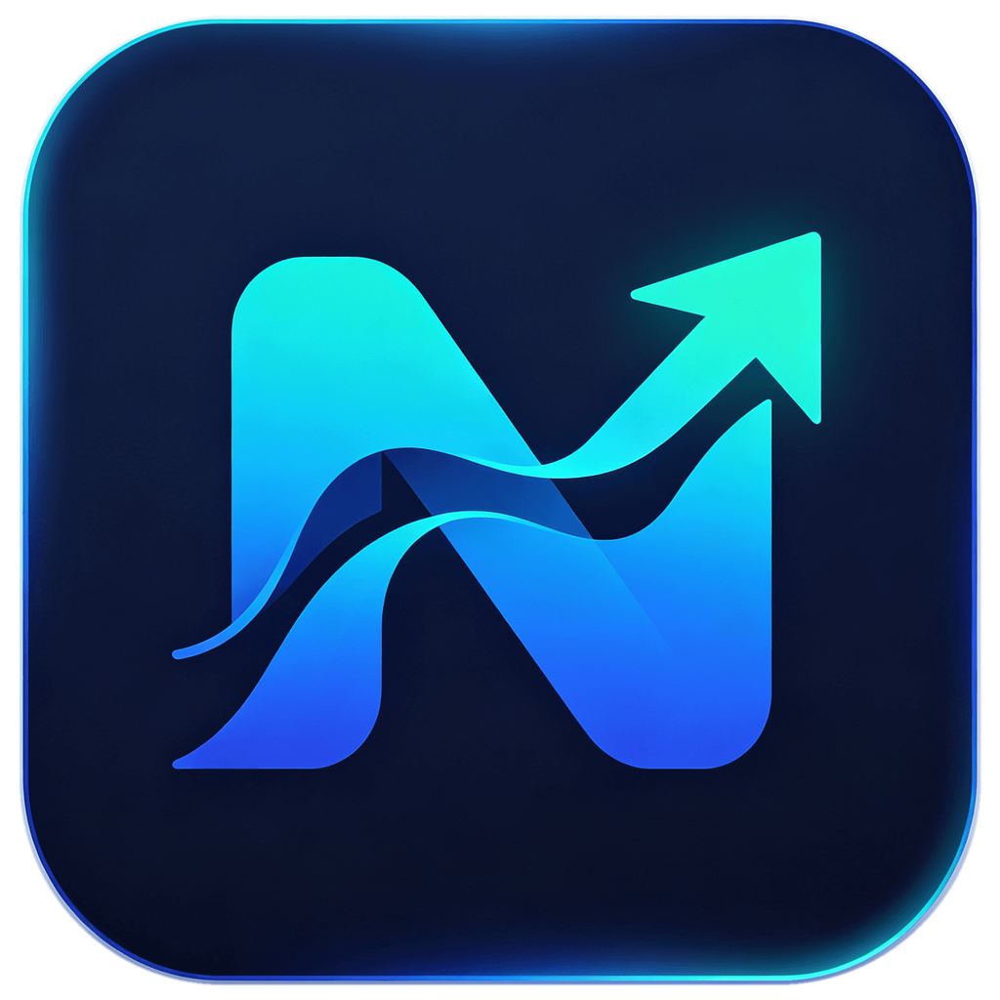
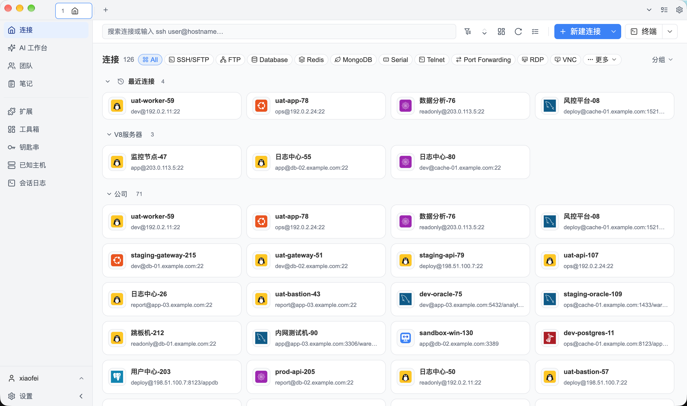
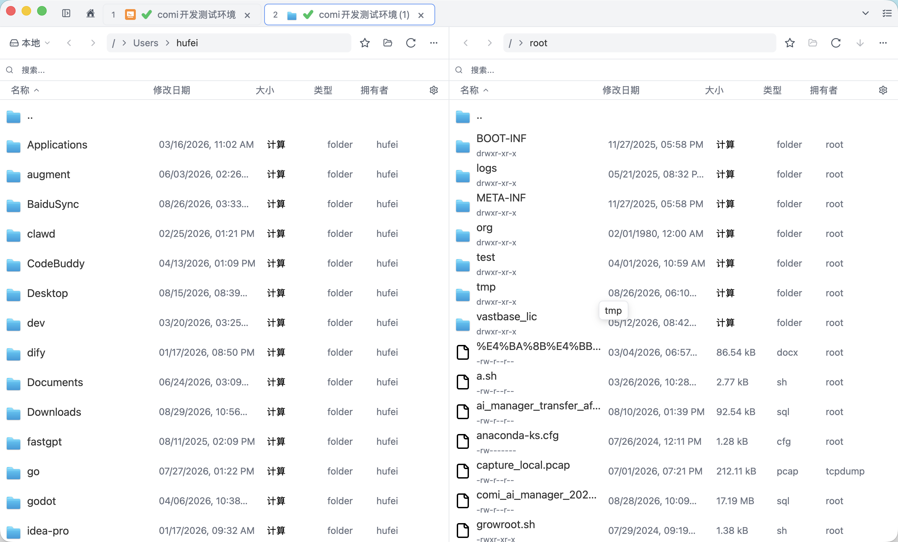
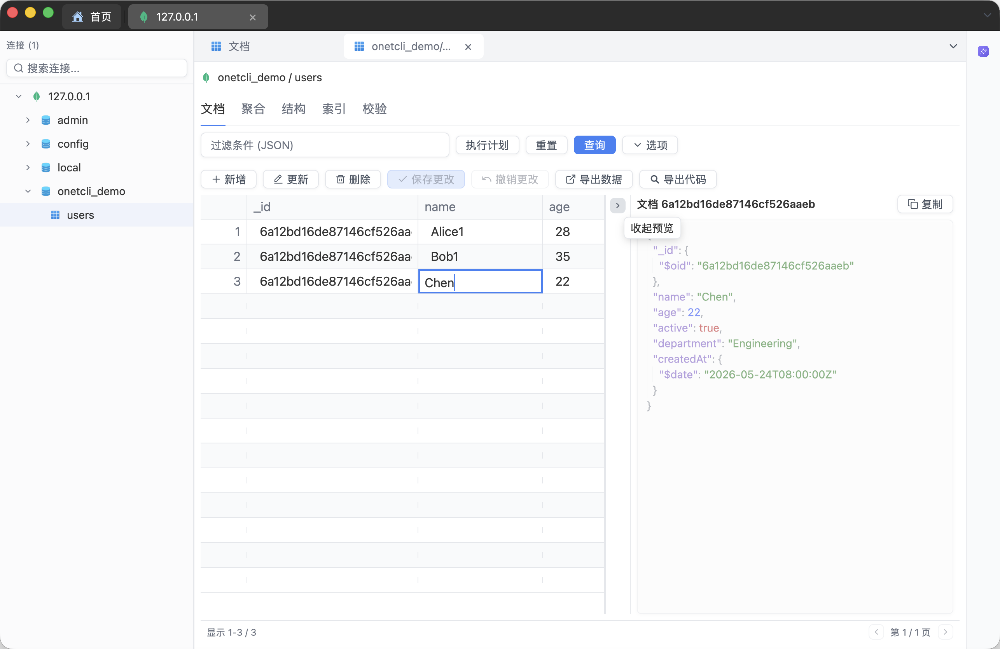
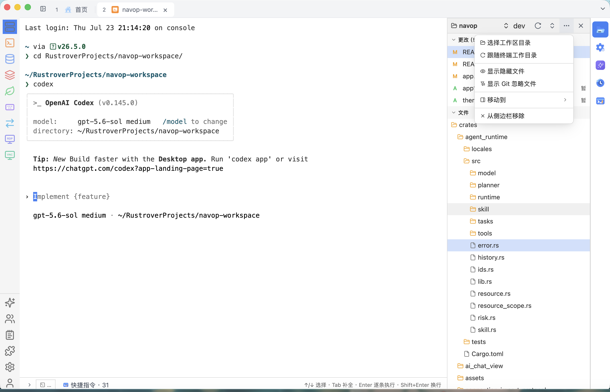
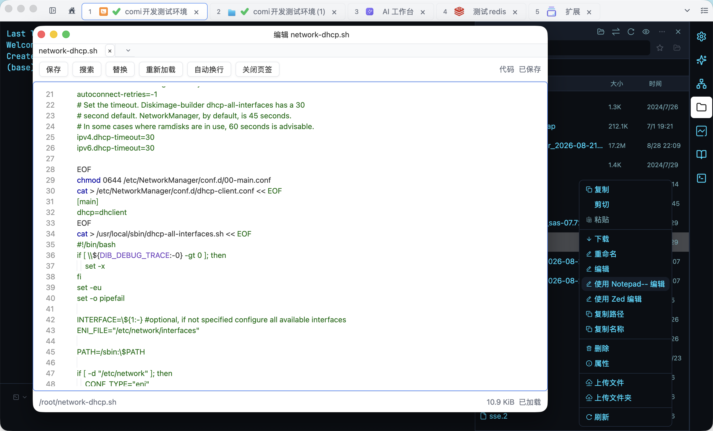
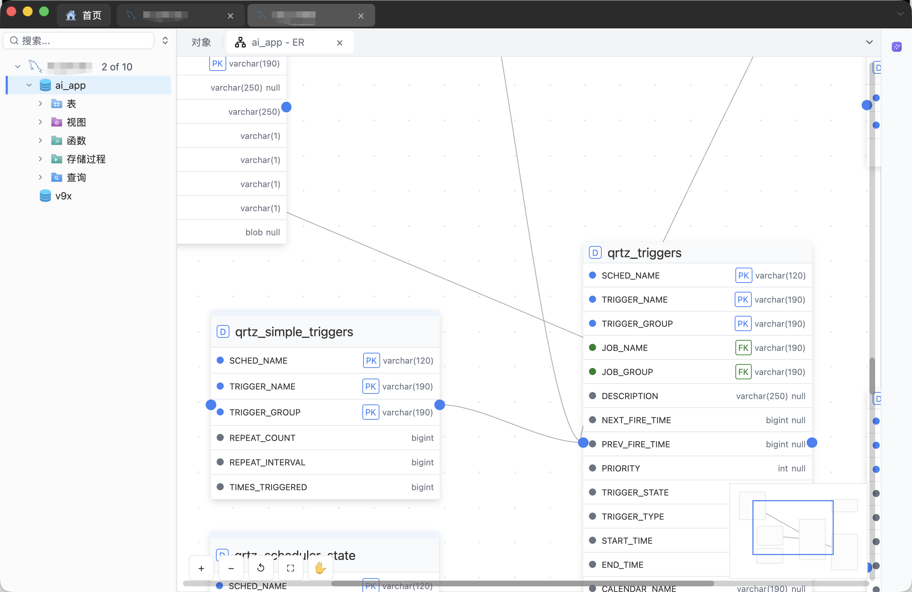
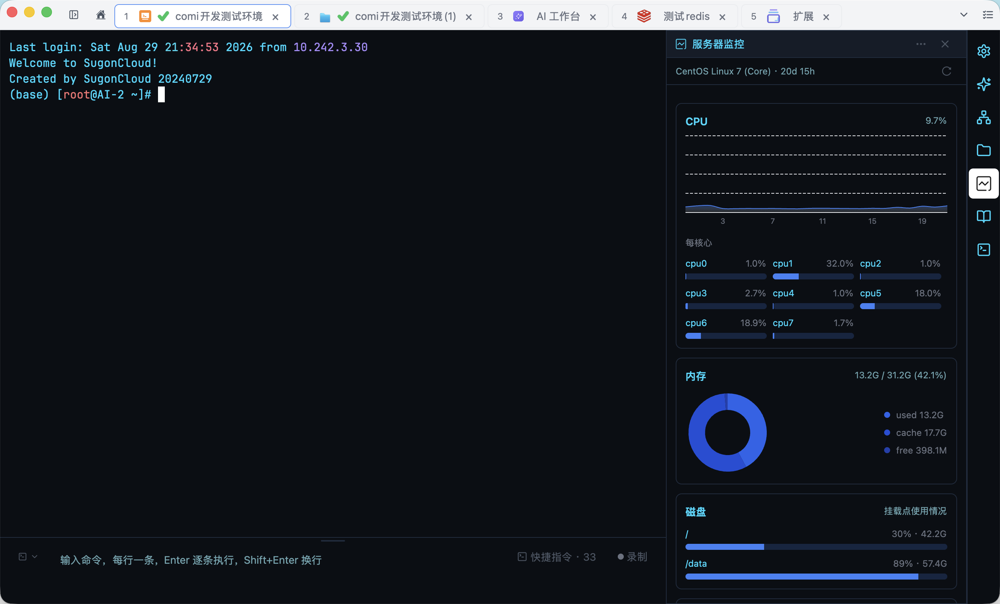
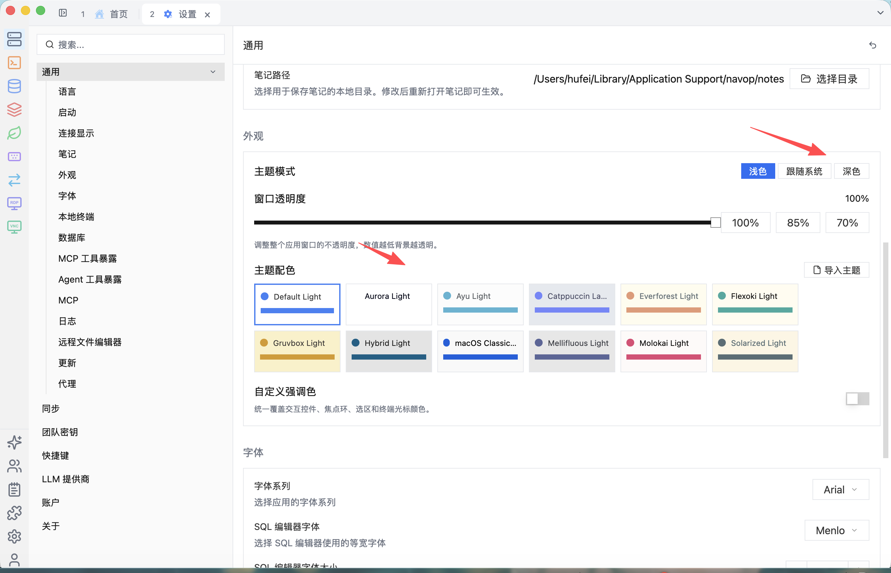

<div align="center">
  <p></p>
  <h1>Navop</h1>
  <p><strong>一套原生内核，三个应用：Navop 全量版、Navop Shell 远程运维、Navop Data 数据工具。</strong></p>
  <p>基于 <a href="https://gpui.rs">GPUI</a> 与 Rust 构建 · GPU 加速渲染 · 无 WebView</p>

  <p>
    <a href="https://github.com/feigeCode/navop/releases"></a>
    <a href="https://github.com/feigeCode/navop/actions/workflows/ci.yml"></a>
    <a href="#许可证"></a>
    <a href="https://qm.qq.com/cgi-bin/qm/qr?k=&group_code=860670605"></a>
    <a href="https://docs.qq.com/doc/DVEFFd2RnSnJLcFBD"></a>
  </p>

  <p>
    
    
    
    
    
    
    
    
    
    
    
    
    
    
    
    
    
    
    
    
    
    
    
    
  </p>

  <p>
    <a href="README.md">English</a> ·
    <a href="https://docs.navop.dev/">使用文档</a> ·
    <a href="https://navop.dev/zh-CN/extensions">下载中心</a> ·
    <a href="#产品家族">产品家族</a> ·
    <a href="#功能特性">功能特性</a> ·
    <a href="#应用截图">应用截图</a> ·
    <a href="#安装">安装</a> ·
    <a href="https://github.com/feigeCode/navop/releases/latest">最新版本</a> ·
    <a href="CONTRIBUTING.md">参与贡献</a>
  </p>

  <p></p>
</div>

## 产品家族

Navop 由三个应用组成，它们共用同一套原生内核，并以相同版本号一同发布。

| 应用 | 定位 | 领域能力 | 平台 | 安装包前缀 | 下载入口 |
|:-:|:-:|:-:|:-:|:-:|:-:|
| **Navop**（全量版） | 一站式桌面工作台 | PostgreSQL、MySQL、MariaDB、SQLite、SQL Server、Oracle、ClickHouse、达梦 DM、金仓 KingbaseES、OceanBase、openGauss 等；Redis；MongoDB；SSH/SFTP；本地与远程终端；端口转发；RDP/VNC 远程桌面；串口/Telnet；SQL 编辑器；ER 图；数据迁移；监控；Notes；AI 工作台；团队同步；扩展市场；Public MCP | macOS arm64/x64、Windows x64/win32、Linux x64/arm64 | `navop-<version>-<label>.<ext>` | [下载中心](https://navop.dev/zh-CN/extensions) · [GitHub](https://github.com/feigeCode/navop/releases) · [CNB](https://cnb.cool/navop-dev/navop/-/releases) |
| **Navop Shell**（远程运维） | 不含数据库工具的远程运维 | SSH/SFTP；本地与远程终端；端口转发；RDP/VNC 远程桌面；串口/Telnet | macOS arm64/x64、Windows x64、Linux x64 | `navop-shell-<version>-<label>.<ext>` | [下载中心](https://navop.dev/zh-CN/extensions) · [GitHub](https://github.com/feigeCode/navop/releases) · [CNB](https://cnb.cool/navop-dev/navop/-/releases) |
| **Navop Data**（数据工具） | 不含远程运维的数据工具 | SQL 工作区；Redis；MongoDB；ER 图；数据迁移 | macOS arm64/x64、Windows x64、Linux x64 | `navop-data-<version>-<label>.<ext>` | [下载中心](https://navop.dev/zh-CN/extensions) · [GitHub](https://github.com/feigeCode/navop/releases) · [CNB](https://cnb.cool/navop-dev/navop/-/releases) |

三者共享 AI 工作台、Notes、团队同步、扩展市场、主题、快捷键、tab 恢复、托盘、单实例、自动更新与 Public MCP。三者同版本发布、可并排安装，数据目录与钥匙串各自独立；只有全量 Navop 注册 `.db`、`.duckdb`、`.md`、`.cast` 文件关联。

## 功能特性

### 数据库与数据工具 —— Navop / Navop Data

- 内置支持 MySQL、PostgreSQL、SQLite、DuckDB、SQL Server、Oracle；ClickHouse 与 TDengine 改为可安装的扩展驱动，与达梦 DM、金仓 KingbaseES、GBase 8s、OceanBase、openGauss、Apache IoTDB 和神通 Oscar 驱动一同通过扩展市场安装。
- 浏览数据库对象，编辑和执行 SQL 并查看执行计划，导入导出数据，比较 Schema/Data，并通过 ER 图查看关系。
- 专用的 Redis 与 MongoDB 界面；MQTT 等中间件连接改为通过扩展市场安装的扩展提供（MQTT 3.1.1 + rustls 加密，支持 SSH 隧道与断线自动重订阅），提供订阅、消息、发布三个视图。
- 表数据页签支持批量编辑选中单元格，日期/时间/数值列使用对应的类型化编辑控件，支持右键复制表名与字段名。

### 远程连接与运维 —— Navop / Navop Shell

- 可拖拽分屏的 SSH 与本地终端，支持快捷命令、广播输入、Shell integration、会话锁定、会话录制回放；会话日志支持搜索、批量删除与增量加载；同时支持 Telnet 与串口连接。
- 通过 SFTP、FTP 与 FTPS 上传下载、搜索、收藏、远程编辑（可配置大小上限与默认编辑器）、拖拽传输、ZMODEM 传输和跨服务器复制管理远程文件。可单独创建 FTP/FTPS 连接，也可在 SSH 连接的远程文件面板中切换协议（终端仍走 SSH）；打开方式偏好可决定双击默认进入终端还是双栏文件视图。
- 可复用的本地、远程（`ssh -R`）与动态 SOCKS 端口转发；X11 转发；主机密钥变更指纹确认；「已知主机」页面可查看、导入和移除信任的 SSH 主机密钥；可按连接启用旧版 SSH 算法。
- 导入 SecureCRT 等外部工具的会话，进行服务器监控，并支持 RDP/VNC 远程桌面。Windows 上集成原生 MSTSC：通过 C++ 宿主将微软 RDP ActiveX 控件直接内嵌到应用中，可在页签内、全屏窗口中连接，也可一键启动原生 `mstsc.exe` 客户端；跨平台则由纯 Rust 的 IronRDP canvas 后端渲染 RDP 会话。

### 编辑、AI 与扩展 —— 三者共享

- 本地 Markdown 笔记，支持 Mermaid 图、数学公式，并可导出为 HTML、PDF 或 DOCX；内置编辑器支持保存快捷键与 WASM 语言解析器语法高亮。
- 使用 AI 生成和解释 SQL、分析数据、生成图表、辅助终端操作、调用工具和运行 Agent 工作流；通过 ACP 接入 Codex、Claude Code 和 OpenCode 等外部 Agent。
- Agent Hub 在同一工作区查看终端 Agent、项目文件、Git 分支、变更列表和并排 Diff；工具箱聚合扩展小工具并与连接扩展区分。
- 扩展市场提供数据库驱动、远程桌面 provider、文档渲染器、连接导入器、外部编辑器，以及由宿主原生渲染的资源工作台（首个为 Docker 工作台，管理容器、镜像、日志、进程与 exec 终端）。官方扩展在 [navop-extensions](https://github.com/feigeCode/navop-extensions) 仓库独立构建发布。
- 快速打开支持临时 SSH 连接，标签栏提供新建连接入口，临时会话无需先保存连接。

### 原生桌面体验 —— 三者共享

- 基于 GPUI 的原生界面与 GPU 加速渲染；亮色、深色、跟随系统模式，可导入主题，并配置强调色和窗口透明度。
- 主页统一网格布局与树形视图，最近连接、批量连接管理，工作区拖拽排序持久化。
- 设置页按数据库、终端、Agent、MCP 拆分为独立分页；快捷键支持清除与禁用系统快捷键。
- 支持 English、简体中文和繁体中文界面。
- 加密同步不同设备上的个人连接、凭据与设置，支持 Navop 云同步和个人同步（文件夹 / Git / WebDAV）。

## Public MCP、Navop CLI 与 Agent Skill

Navop 可将选定的宿主权威工具开放给外部 Codex、Claude、MCP 客户端和自动化程序。请在 **设置 > 通用 > MCP > MCP Server** 中开启服务、选择权限档位（安全 / 确认 / 自动），并在 **Tool Exposure** 中只启用需要的工具组。runtime 只监听动态 loopback 端口，并使用用户专属 discovery token 验证客户端；实时工具、Schema、权限、审批和审计始终由正在运行的 Navop 控制。

终端型 Agent 需要安装 [`@navop/cli`](https://github.com/feigeCode/navop-mcp) 及其内置的 Navop Skill：

```bash
npm install -g @navop/cli@latest

# 为 Codex 安装 Skill；Agents 兼容客户端可改用 --target agents
navop skill install --target codex --scope user
```

三个应用各自运行独立的 MCP 服务，分别以 `navop`、`navop-shell`、`navop-data` 被发现、分别授权；CLI 与 Skill 的用法在三个产品上完全一致，无需改动。

独立的 [`@navop/mcp`](https://github.com/feigeCode/navop-mcp) 仅用于为原生 MCP 客户端提供 stdio bridge（`npx -y @navop/mcp@latest`）。完整命令参考和客户端配置请查看 [Navop MCP 与 CLI 仓库](https://github.com/feigeCode/navop-mcp)与 [Public MCP 使用指南](https://docs.navop.dev/guide/public-mcp)。

## 应用截图

| 工作台总览 |
|:-:|
| [](app1.png) |

| 数据库 | SSH |
|:-:|:-:|
| [](database.png) | [](ssh.png) |

| SFTP | Redis |
|:-:|:-:|
| [](sftp.png) | [](redis.png) |

| MongoDB |                AI 对话                 |
|:-:|:------------------------------------:|
| [](mongodb.png) | [](ai_chat.png) |

| Agent Hub | 扩展市场 |
|:-:|:-:|
| [](agent_hub.png) | [](extension.png) |

| 远程文件编辑 | ER 图 |
|:-:|:-:|
| [](remote_file_editor.png) | [](er.png) |

| 服务器监控 | 主题 |
|:-:|:-:|
| [](monitor.png) | [](theme.png) |

## 安装

Navop、Navop Shell 与 Navop Data 由同一份源码构建，并以相同版本号一同发布。请从[下载中心](https://navop.dev/zh-CN/extensions)、[GitHub Releases](https://github.com/feigeCode/navop/releases) 或 [CNB 镜像](https://cnb.cool/navop-dev/navop/-/releases)下载；所有产物也同步在 R2 镜像 `https://navop.pdyyds.cn/releases/<tag>/<file>`，将 `<tag>` 与 `<file>` 替换为实际版本标签和文件名即可。

### 安装包与平台

安装包命名遵循 `<产品>-<version>-<label>.<ext>`：

- `navop-<version>-<label>.<ext>` —— 全量 Navop
- `navop-shell-<version>-<label>.<ext>` —— Navop Shell
- `navop-data-<version>-<label>.<ext>` —— Navop Data

支持的 label 为 `macos-arm64`、`macos-x64`、`windows-x64` 和 `linux-x64`；全量 Navop 另有 `win32` 与 `linux-arm64`。

| 产品 | macOS | Windows | Linux |
|:-:|:-:|:-:|:-:|
| Navop | `.dmg`、`.tar.gz`（arm64、x64） | `.msi`、`.exe`、`.zip`、`-portable.zip`（x64、win32） | `.tar.gz`、`-portable.tar.gz`（x64、arm64）；`.deb`、`.rpm`、`.AppImage`、`-gpu-stack.tar.gz`（x64） |
| Navop Shell | `.dmg`、`.tar.gz`（arm64、x64） | `.msi`、`.exe`、`.zip`、`-portable.zip`（x64） | `.tar.gz`、`-portable.tar.gz`（x64） |
| Navop Data | `.dmg`、`.tar.gz`（arm64、x64） | `.msi`、`.exe`、`.zip`、`-portable.zip`（x64） | `.tar.gz`、`-portable.tar.gz`（x64） |

独立产品不提供 `win32`、`linux-arm64`、`.deb`/`.rpm`/`.AppImage` 以及 GPU 依赖包。每个版本都包含用于校验文件的 `sha256sums.txt`。

### macOS

打开 `.dmg` 或解压 `.tar.gz`，然后把应用移到 `/Applications`，即 `Navop.app`、`Navop Shell.app` 或 `Navop Data.app`。如果 Gatekeeper 提示“Apple 无法检查其是否包含恶意软件”，请按已安装的产品清除隔离属性：

```bash
sudo xattr -rd com.apple.quarantine /Applications/Navop.app
sudo xattr -rd com.apple.quarantine "/Applications/Navop Shell.app"
sudo xattr -rd com.apple.quarantine "/Applications/Navop Data.app"
```

### Windows

运行 `.msi` 或 `.exe` 安装程序即可；`.zip` 是普通压缩包，`-portable.zip` 会把数据保存在安装目录内。全量 Navop 还可以通过 [Scoop](https://scoop.sh) 安装（使用便携版包，数据持久化由 Scoop 管理）：

```powershell
scoop bucket add extras
scoop install navop
```

Scoop 只覆盖全量 Navop；Navop Shell 与 Navop Data 请从下载中心、GitHub Releases 或 CNB 获取。

### Linux

`.tar.gz` 可在任意目录运行，`-portable.tar.gz` 会把数据保存在可执行文件旁边。在 linux-x64 上，全量 Navop 还提供 `.deb`、`.rpm`、`.AppImage` 安装包，以及包含 GPU 依赖的 `-gpu-stack.tar.gz`；Navop Shell 与 Navop Data 只提供 `.tar.gz` 和 `-portable.tar.gz`。

全量 Navop 也已在 [FlatPark](https://flatpark.org/zh-Hans/apps/dev.navop.Navop/) 上架社区 Flatpak 软件包：

```bash
flatpak --user remote-add --if-not-exists flatpark https://dl.flatpark.org/flatpark.flatpakrepo
flatpak --user install flatpark dev.navop.Navop
```

Flatpak 仅覆盖全量 Navop。

### 更新与数据位置

每个产品使用独立的更新清单：

- Navop —— `https://navop.pdyyds.cn/updates/latest.json`
- Navop Shell —— `https://navop.pdyyds.cn/updates/navop-shell/shell/latest.json`
- Navop Data —— `https://navop.pdyyds.cn/updates/navop-data/data/latest.json`

配置、应用数据与钥匙串同样各自独立。配置目录在 macOS/Linux 为 `~/.config/<产品>`，在 Windows 为 `%APPDATA%\<产品>`（`<产品>` 为 `navop`、`navop-shell` 或 `navop-data`）；应用数据目录在 macOS 为 `~/Library/Application Support/<产品>`，在 Linux 为 `~/.local/share/<产品>`，在 Windows 为 `%APPDATA%\<产品>`。凭据使用各自的钥匙串服务：`com.navop.desktop`、`com.navop.shell`、`com.navop.data`。便携版把数据保存在 `<安装目录>/data`，并分别以 `navop.portable`、`navop-shell.portable`、`navop-data.portable` 作为标记。

完整的安装包选择表、Windows 便携模式说明、v0.10.1 及更早版本 ZIP 的升级迁移，以及 Oracle Instant Client / 纯 Go 驱动说明，请参阅[安装与更新指南](https://docs.navop.dev/guide/install-update)。

## 从源码构建

Navop 使用 Rust 2024 edition，并需要安装各平台的系统依赖。

```bash
# 安装 Linux 依赖
./script/bootstrap

# 运行全量应用
cargo run -p navop

# 运行独立产品
cargo run -p navop-shell
cargo run -p navop-data
```

Windows 请在 PowerShell 中安装依赖：

```powershell
.\script\install-window.ps1
```

常用开发检查：

```bash
cargo build
cargo test --all
cargo clippy --workspace --all-targets
cargo fmt --check
```

完整开发指南请参阅 [CONTRIBUTING.md](CONTRIBUTING.md)。

## 社区与支持

Navop 由个人长期维护。Star、聚焦的小型 PR 和 Bug 报告都有助于项目持续发展。

- [反馈 Bug 或提出功能建议](https://github.com/feigeCode/navop/issues)
- QQ 群：[860670605](https://qm.qq.com/cgi-bin/qm/qr?k=&group_code=860670605)
- 微信群：[加入](https://docs.qq.com/doc/DVEFFd2RnSnJLcFBD)
- 旧版 OnetCli 仓库：[feigeCode/onetcli](https://github.com/feigeCode/onetcli)

## Star History

<a href="https://star-history.dera.page/#feigeCode/navop&type=date&logscale=&legend=top-left">
 <picture>
   <source media="(prefers-color-scheme: dark)" srcset="https://star-history.dera.page/svg?repos=feigeCode/navop&type=date&theme=dark&logscale&legend=top-left" />
   <source media="(prefers-color-scheme: light)" srcset="https://star-history.dera.page/svg?repos=feigeCode/navop&type=date&logscale&legend=top-left" />
   
 </picture>
</a>

## 致谢

ER 图渲染基于 [ferrum-flow](https://github.com/tu6ge/ferrum-flow.git)。

## 许可证

Navop 源代码基于 [Apache License 2.0](LICENSE-APACHE) 开源。Navop 自有代码还须遵守 [Navop 补充协议](NAVOP_LICENSE)，该协议允许通过免费分发渠道（如 GitHub Releases、Flatpak 仓库和免费应用商店）免费分发，但禁止商业转售、收取费用、竞争性产品或服务以及付费分发平台。第三方组件继续适用其各自的许可证。

如有许可证与版权相关问题，请联系 xiaofei.hf@gmail.com。
