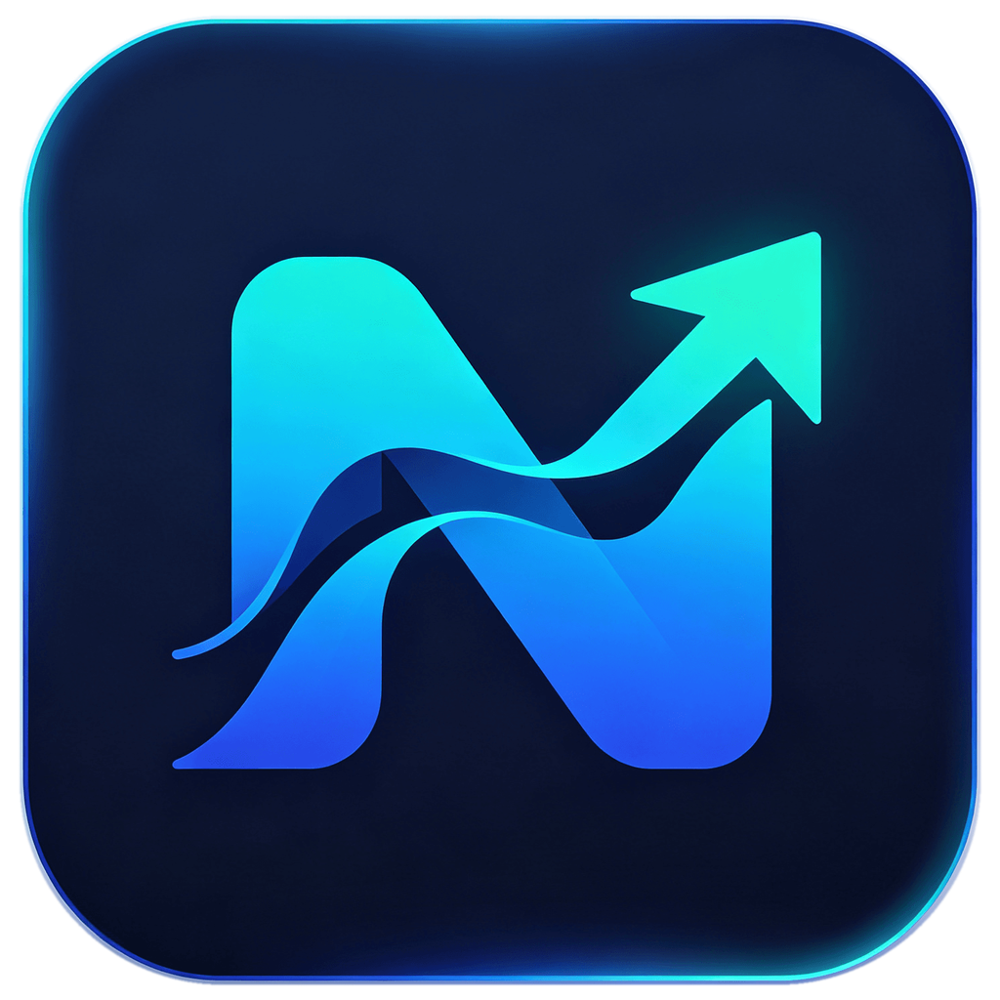
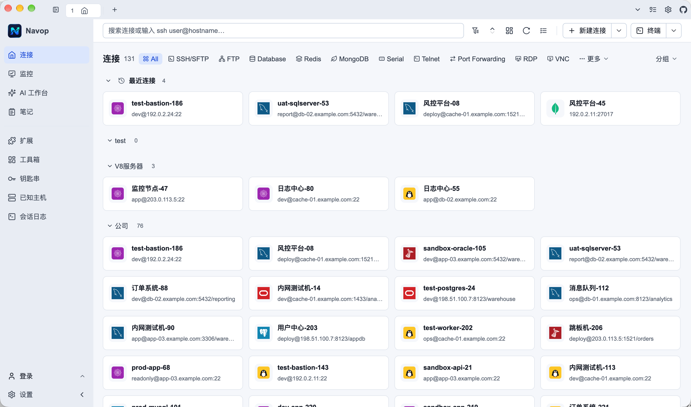
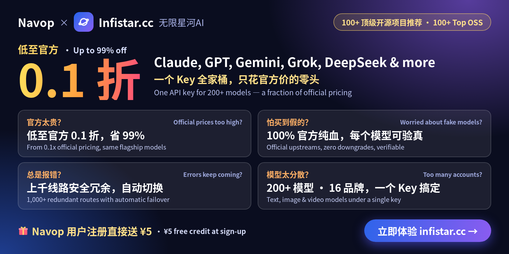
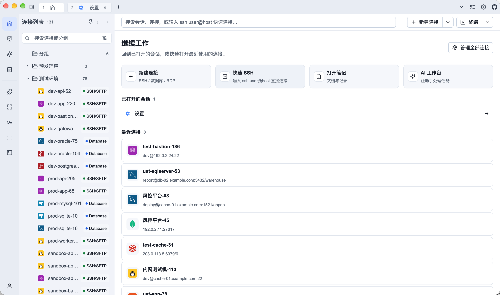
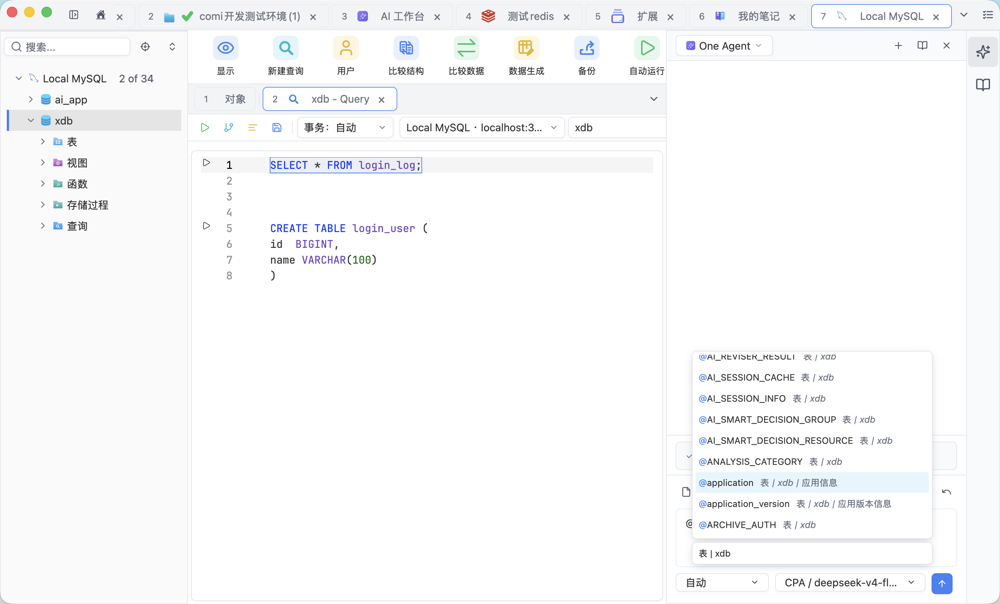
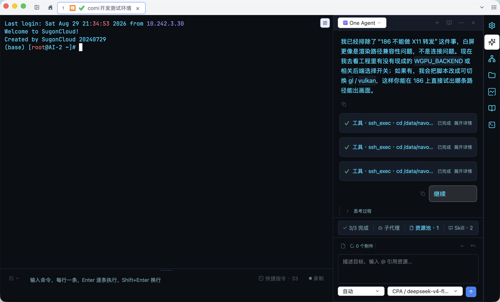
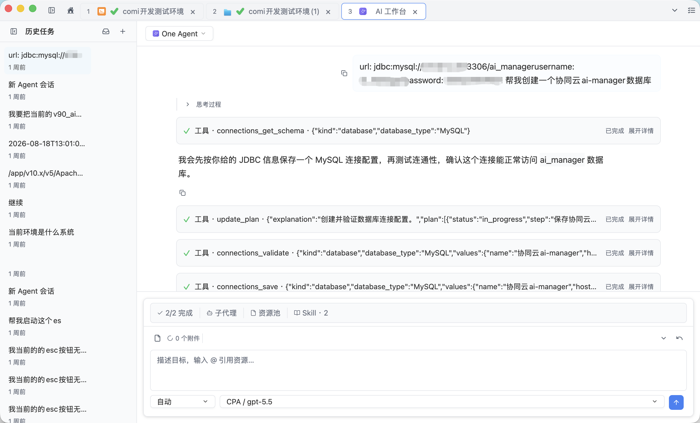
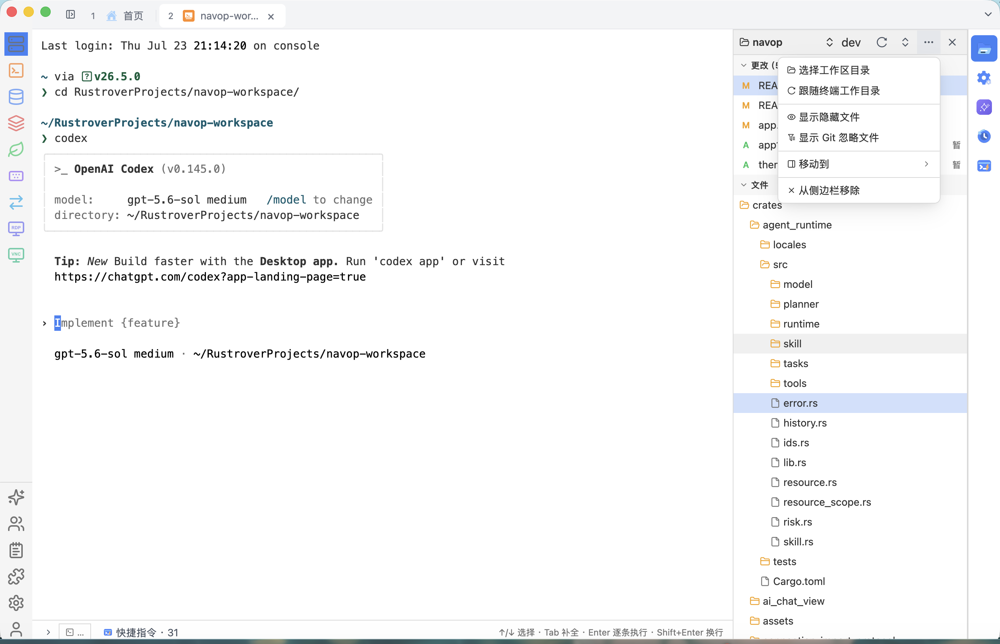
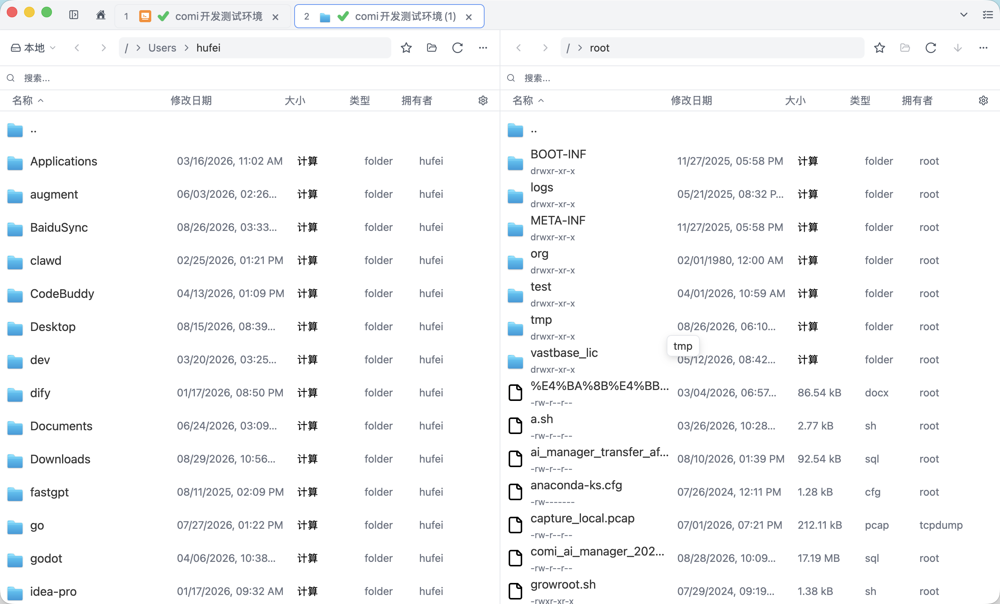
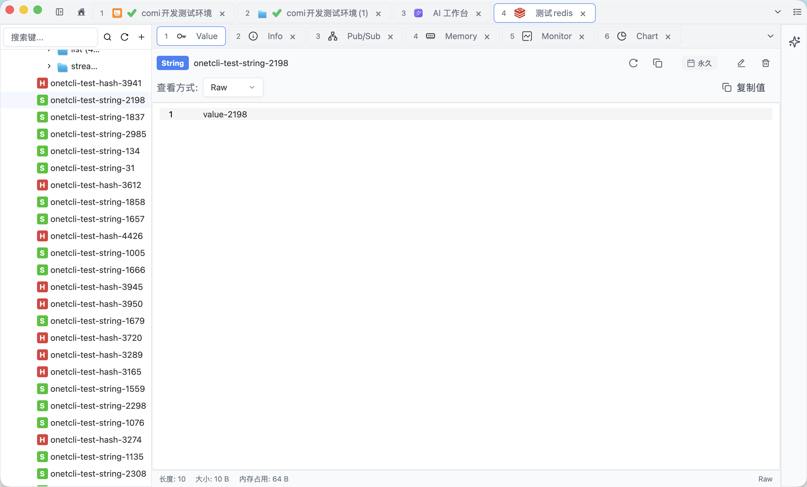

<div align="center">
  <p></p>
  <h1>Navop</h1>
  <p><strong>データベース、サーバー、AI のためのネイティブデスクトップワークスペース — Rust で書かれ、<a href="https://gpui.rs">GPUI</a> で描画されています。</strong></p>
  <p>Rust + GPUI · GPU アクセラレーションによる描画 · WebView なし · Electron なし</p>

  <p>
    <a href="https://github.com/feigeCode/navop/releases"></a>
    <a href="https://github.com/feigeCode/navop/actions/workflows/ci.yml"></a>
    <a href="#ライセンス"></a>
    <a href="https://qm.qq.com/cgi-bin/qm/qr?k=&group_code=860670605"></a>
    <a href="https://docs.qq.com/doc/DVEFFd2RnSnJLcFBD"></a>
  </p>

  <p>
    
    
    
    
    
    
    
    
    
    
    
    
    
    
    
    
    
    
    
    
    
    
    
    
  </p>

  <p>
    <a href="README.md">English</a> ·
    <a href="README_CN.md">中文</a> ·
    <a href="https://docs.navop.dev/en-US/">ドキュメント</a> ·
    <a href="https://navop.dev/en-US/extensions">ダウンロードセンター</a> ·
    <a href="#rust--gpui-で構築">Rust + GPUI</a> ·
    <a href="#navop-がサポートするもの">機能</a> ·
    <a href="#スクリーンショット">スクリーンショット</a> ·
    <a href="#インストール">インストール</a> ·
    <a href="https://github.com/feigeCode/navop/releases/latest">最新リリース</a> ·
    <a href="CONTRIBUTING.md">コントリビューション</a>
  </p>

  <p></p>
</div>

## ❤️ スポンサー

<table>
  <tr>
    <td align="center" valign="middle" width="340">
      <a href="https://www.infistar.cc/register?aff=TKUN9HBM&amp;ref_source=link">
        
      </a>
    </td>
    <td>
      Navop × Infistar.cc | 1 つの API キーで、Navop の SQL 生成と AI チャットで Claude、GPT、Gemini、Grok、DeepSeek などを利用できます。公式価格から最大 99% 節約でき、すべてのモデルは検証可能な公式チャネルから提供されます。16 ブランドの 200 以上のモデルから選択でき、1,000 以上の冗長ルートと自動フェイルオーバーに支えられています。<a href="https://www.infistar.cc/register?aff=TKUN9HBM&amp;ref_source=link">Navop のリンクから登録すると、5 人民元分のトライアルクレジットがもらえます</a>。
    </td>
  </tr>
</table>

## Navop とは

Navop は、データベース、サーバー、AI にまつわる作業のためのネイティブデスクトップワークスペースです。データベースや Redis/MongoDB のクライアント、SSH/SFTP とターミナル、リモートデスクトップ、AI エージェントが、別々のツールではなく 1 つのウィンドウに共存します。

Rust で書かれ、Zed の GPU アクセラレーション対応 UI フレームワークである [GPUI](https://gpui.rs) で描画されています。WebView も Electron も、組み込みブラウザのランタイムもありません。

## Rust + GPUI で構築

| | |
|:-:|:--|
| **言語** | UI、データベースドライバー、SSH/SFTP スタック、ターミナルエミュレーション、AI ランタイム、MCP サーバーに Rust 2024 を使用 |
| **UI** | GPU アクセラレーションによるレイアウトと描画を行う GPUI。大きなグリッド、ターミナル、チャートも快適に動作します |
| **ランタイム** | 組み込みブラウザ、Node.js、Web アセットを含まない、自己完結型の単一ネイティブバイナリ |
| **プラットフォーム** | macOS arm64/x64、Windows x64/win32、Linux x64/arm64 |
| **ネイティブ統合** | ネイティブのメニュー、ショートカット、ファイルダイアログ、トレイ、キーチェーン、ファイルの関連付け、自動更新 |
| **拡張性** | ドライバー、レンダラー、リソースワークベンチ向けの WASM コンポーネント拡張。再起動なしで読み込まれます |

このように構築している理由:

- **最初から最後まで 1 つの言語。** ドライバー、SSH トランスポート、ターミナルエミュレーション、UI が 1 つの Rust ワークスペースを共有しているため、ブラウザとのブリッジや 2 つ目のランタイムなしで機能を組み合わせられます。
- **DOM レイアウトではなく GPU 描画。** GPUI は変更された部分だけを描画するため、複数の接続がアクティブな状態でも、複数ペインのターミナル、幅の広いテーブル、チャートが滑らかに動作します。
- **WebView なし。** すべてのプラットフォームでネイティブのテキスト描画、入力メソッド、アクセシビリティ、ウィンドウ管理、ショートカットを、より小さく自己完結したインストールで提供します。

## Navop がサポートするもの

- **データベース** — MySQL、PostgreSQL、MariaDB、SQLite、DuckDB、SQL Server、Oracle、ClickHouse、TDengine。拡張ドライバーで Dameng、KingbaseES、GBase、OceanBase、openGauss、IoTDB、Oscar に対応。実行計画、インポート／エクスポート、スキーマとデータの比較、ER 図を備えた SQL エディター。
- **Redis、MongoDB、MQTT** — キー／バリューとドキュメントの閲覧に加え、拡張機能による MQTT の pub/sub。
- **SSH とターミナル** — ローカルとリモートのシェル、ペイン分割、クイックコマンド、ブロードキャスト入力、セッション録画、検索可能なログ。
- **ファイルとリモートアクセス** — リモート編集対応の SFTP/FTP/FTPS、ポートフォワーディング、X11、RDP/VNC、Telnet、シリアル。
- **AI と自動化** — SQL の生成と分析、チャート、ターミナルのヘルプ、ACP エージェント（Codex、Claude Code、OpenCode）、Agent Hub、Public MCP。
- **デスクトップとチーム** — ネイティブテーマ、English/简体中文/繁體中文、暗号化された同期、共有接続、拡張機能マーケットプレイス、Markdown ノート。

Navop は全機能を備えたビルドです。同じソースから、より限定的なインストール向けのエディションとして **Navop Shell**（SSH、ターミナル、ポートフォワーディング、リモートデスクトップ）と **Navop Data**（SQL、Redis、MongoDB、ER 図）も提供されています。

## Public MCP、Navop CLI、Agent Skill

Navop は、ホストが管理するツールを Codex、Claude、その他の MCP クライアントに公開できます。**Settings > General > MCP > MCP Server** を有効にし、Safe / Confirm / Auto を選択して、**Tool Exposure** で公開するツールを制限します。サーバーはループバック専用のポートにバインドし、ユーザー専用のディスカバリートークンでクライアントを認証します。

```bash
npm install -g @navop/cli@latest
navop skill install --target codex --scope user
```

`@navop/mcp` は、ネイティブの MCP クライアント向けの stdio ブリッジです（`npx -y @navop/mcp@latest`）。クライアントの設定については、[Public MCP ガイド](https://docs.navop.dev/en-US/guide/public-mcp)を参照してください。

## スクリーンショット

| ワークスペース |
|:-:|
| [](app1.png) |

| データベース | SSH |
|:-:|:-:|
| [](database.png) | [](ssh.png) |

| AI チャット | Agent Hub |
|:-:|:-:|
| [](ai_chat.png) | [](agent_hub.png) |

| SFTP | Redis |
|:-:|:-:|
| [](sftp.png) | [](redis.png) |

## インストール

Navop は、[ダウンロードセンター](https://navop.dev/en-US/extensions)、[GitHub Releases](https://github.com/feigeCode/navop/releases)、または [CNB ミラー](https://cnb.cool/navop-dev/navop/-/releases)からダウンロードできます。すべてのアセットは `https://navop.pdyyds.cn/releases/<tag>/<file>` からも入手でき、検証用の `sha256sums.txt` も用意されています。

| プラットフォーム | パッケージ |
|:-:|:-:|
| macOS | `.dmg`、`.tar.gz`（arm64、x64） |
| Windows | `.msi`、`.exe`、`.zip`、`-portable.zip`（x64、win32） |
| Linux | `.tar.gz`、`-portable.tar.gz`（x64、arm64）、`.deb`、`.rpm`、`.AppImage`（x64） |

- **macOS:** `.dmg` を開いて `Navop.app` を `/Applications` に移動します。Gatekeeper にブロックされた場合は、`sudo xattr -rd com.apple.quarantine /Applications/Navop.app` を実行してください。
- **Windows:** `.msi` または `.exe` を実行します。`.zip` はポータブル版で、`-portable.zip` は実行ファイルと同じ場所にデータを保存します。`scoop install navop` でも入手できます。
- **Linux:** アーカイブを任意のディレクトリから実行するか、`.deb`、`.rpm`、`.AppImage` をインストールします。

同じソースから、より小さな 2 つのエディションもビルドされます。**Navop Shell**（SSH、ターミナル、ポートフォワーディング、リモートデスクトップ）と **Navop Data**（SQL、Redis、MongoDB、ER 図）です。これらは Navop のネイティブシェル、AI、同期、拡張機能システムを共有しており、並べてインストールできます。ほとんどのユーザーは Navop から始めるのがおすすめです。これらのパッケージには `navop-shell-` と `navop-data-` の接頭辞が付いています。成果物の一覧とポータブルモードの詳細については、[インストールガイド](https://docs.navop.dev/en-US/guide/install-update)を参照してください。

## ソースからビルド

Navop は Rust 2024 エディションを使用しており、プラットフォーム固有のシステム依存関係が必要です。

```bash
# Linux dependencies
./script/bootstrap

# Run the application
cargo run -p navop
```

Windows では、PowerShell から次のコマンドで依存関係をインストールします:

```powershell
.\script\install-window.ps1
```

開発時によく使うチェック:

```bash
cargo build
cargo test --all
cargo clippy --workspace --all-targets
cargo fmt --check
```

開発ガイドの全体については、[CONTRIBUTING.md](CONTRIBUTING.md) を参照してください。

## コミュニティとサポート

Navop は独立してメンテナンスされています。Star、焦点を絞ったプルリクエスト、バグ報告のすべてがプロジェクトの継続を支えます。

- [バグの報告や機能のリクエスト](https://github.com/feigeCode/navop/issues)
- QQ グループ: [860670605](https://qm.qq.com/cgi-bin/qm/qr?k=&group_code=860670605)
- WeChat グループ: [参加する](https://docs.qq.com/doc/DVEFFd2RnSnJLcFBD)
- 旧 OnetCli リポジトリ: [feigeCode/onetcli](https://github.com/feigeCode/onetcli)

## Star History

<a href="https://star-history.dera.page/#feigeCode/navop&type=date&logscale=&legend=top-left">
  <picture>
    <source media="(prefers-color-scheme: dark)" srcset="https://star-history.dera.page/svg?repos=feigeCode/navop&type=date&theme=dark&logscale&legend=top-left" />
    <source media="(prefers-color-scheme: light)" srcset="https://star-history.dera.page/svg?repos=feigeCode/navop&type=date&logscale&legend=top-left" />
    
  </picture>
</a>

## クレジット

ER 図の描画は [ferrum-flow](https://github.com/tu6ge/ferrum-flow.git) をベースにしています。

## ライセンス

Navop のソースコードは [Apache License 2.0](LICENSE-APACHE) でライセンスされています。Navop が作成した部分には、さらに [Navop Supplementary License](NAVOP_LICENSE) が適用されます。このライセンスは、無料の配布チャネル（GitHub Releases、Flatpak リポジトリ、無料のアプリストアなど）を通じた自由な再配布を許可する一方で、商用での再販売、料金の請求、競合する製品やサービス、有料の配布プラットフォームを禁止しています。サードパーティのコンポーネントには、それぞれのライセンスが引き続き適用されます。

ライセンスに関するお問い合わせは、xiaofei.hf@gmail.com までご連絡ください。
