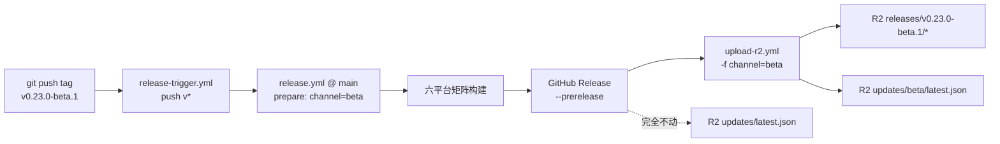

# Beta 发布通道设计

> 文档状态：已实现（M0 服务端：GitHub Actions + `script/`；M1 客户端：`crates/app_kit/src/update/`、`main/src/settings/update_channel.rs`）
>
> 目标读者：发布流水线维护者、桌面端更新模块开发者
>
> 编写日期：2026-10-31

---

## 1. 背景与问题

在此之前的更新链路只有一个 R2 清单：`updates/latest.json`。任何 tag 发布都会无条件覆盖它，
而老客户端只认识这一个地址。于是「发一个测试版」和「把全体用户推上测试版」是同一件事：
`v0.23.0-beta.1` 一旦发布，所有稳定用户下一次检查更新就会收到 beta。

beta 通道要解决的就是这两件事的分离：

- 测试版有独立的清单地址 `updates/beta/latest.json`，稳定清单完全不受影响；
- beta 的 GitHub Release 必须标记为 prerelease，避免 GitHub `/releases/latest` 把测试版当作最新稳定版；
- 老客户端（不认识通道概念）继续只读 `updates/latest.json`，行为不变。

## 2. 通道分层

| 维度 | stable | beta |
| --- | --- | --- |
| 版本号形态 | `vX.Y.Z` | `vX.Y.Z-beta.N`（正则允许的任意预发布后缀） |
| GitHub Release | 普通 Release | `--prerelease` |
| R2 更新清单 | `updates/latest.json` | `updates/beta/latest.json` |
| 安装包前缀 | `releases/<tag>/` | `releases/<tag>/` |
| 目标用户 | 全体用户默认 | 仅在设置中显式切换到 beta 通道的用户 |
| 清单 cache-control | `no-store, max-age=0` | `no-store, max-age=0` |



## 3. 清单与安装包布局

```
<NAVOP_PUBLIC_BASE_URL>/
├── updates/
│   ├── latest.json          # 稳定清单：老客户端唯一入口，beta 发布绝不触碰
│   └── beta/
│       └── latest.json      # beta 清单：仅 beta 通道客户端读取
└── releases/
    ├── v0.22.0/             # 稳定版安装包
    │   └── navop-<target>.<ext>
    └── v0.23.0-beta.1/      # beta 安装包
        └── navop-<target>.<ext>
```

- 清单 schema 保持不变（`schema_version: 1`，字段 `version` / `release_page_url` /
  `release_notes` / `downloads` / `fallback_downloads` / `sha256s` / `packages`）。
  通道由**存放路径**表达，不往清单里加字段——老客户端对未知字段的容忍度不应被赌。
- 安装包 URL 结构仍是 `releases/<tag>/<file>`，与清单里的 `downloads` 一一对应。
- 清单上传后按 key 回读校验（size / sha256 元数据 / cache-control），beta 清单同样走这套校验。
- 安装包 `cache-control` 为 `public, max-age=0, must-revalidate`，允许同 tag 修复时覆盖。

- prune 语义（已在 M1 补齐）：稳定版发布只清理 `releases/` 前缀，beta tag 整体跳过；稳定版清理时
  **额外保留 `updates/beta/latest.json` 里 `version` 指向的那个安装包目录**，否则 beta 清单的下载链接会
  404。清单读取失败（首次 beta 之前、对象不存在）时退回「保留版本号最大的一个 beta」。
  `updates/` 前缀下的任何对象都不删。

## 4. 通道推导规则

唯一规则（`release.yml` 与 `upload-r2.yml` 各写一份，必须一字不差）：

```bash
if [[ "$TAG" =~ ^v[0-9]+\.[0-9]+\.[0-9]+$ ]]; then CHANNEL=stable; else CHANNEL=beta; fi
```

- 纯 `vX.Y.Z` → `stable`；其余（`-beta.N`、`-rc.N`、`-hotfix.N` 等）→ `beta`。
  预发布一律不进稳定清单，这是安全默认值。
- `release.yml` 的 `prepare` job 从 `steps.release.outputs.tag` 推导，写入 `channel` output，
  后续 step 通过 `needs.prepare.outputs.channel` 使用。
- `upload-r2.yml` 的 `channel` input 显式优先；留空才按 tag 推导，且推导结果要过白名单
  （只允许 `stable` / `beta`，否则 `::error::` + `exit 1`）。
- 派发 `upload-r2.yml` 时**必须**显式传 `-f channel=...`，不允许下游自己猜。

## 5. 服务端实现映射（M0）

| 文件 | 职责 |
| --- | --- |
| `.github/workflows/release-trigger.yml` | 无改动：push `v*` → 派发 `release.yml`（workflow 定义永远取 `main`） |
| `.github/workflows/release.yml` | `prepare` 推导并输出 `channel`；创建/更新 GitHub Release 时仅 beta 追加 `--prerelease`；派发 `upload-r2.yml` 带 `-f channel="$CHANNEL"` |
| `.github/workflows/upload-r2.yml` | 新增 `channel` input；推导 + 白名单校验；清单 key `stable → updates/latest.json`、`beta → updates/beta/latest.json`；上传/回读校验逻辑复用 |
| `script/beta-release.sh` | 一条命令完成 beta 版本 + changelog + commit + tag + push（`--base` / `--next` / `--notes-file` / `--dry-run`） |
| `script/test-release-packaging.mjs` | 文本断言 + 假 aws 仿真：beta tag 只写 `updates/beta/latest.json` |

`--prerelease` 的实现细节：用数组承载可选参数，空数组在 `set -u` 下展开必须写成
`${prerelease_args[@]+"${prerelease_args[@]}"}`，否则 stable 发布会因 unbound variable 直接失败。

> 上线前置条件：`release-trigger.yml` 用 `--ref main` 取 workflow 定义，因此本节的 workflow 改动
> 必须先合入 `main` 才能生效；在此之前打 beta tag，跑的仍是 main 上的旧版 `release.yml`。

## 6. 客户端如何消费（已实现）

- 设置字段：`one_core::settings::AppSettings::update_channel: Option<UpdateChannel>`（`stable` / `beta`，
  `None` = 跟随构建版本）。落盘 `settings.json`，老配置文件缺字段时按 `None` 处理。
- 通道解析：`app_kit::update::effective_channel(configured)` = 显式选择优先，否则
  `UpdateChannel::from_version(current_version())`（版本号含 `-` 即 Beta）。因此预发布构建默认就在
  beta 通道上，稳定构建默认 stable。
- feed 由通道派生（`crates/app_kit/src/update/config.rs` 的 `feed_url`）：
  - stable → `<base>/updates/latest.json`（全量产品）/ `<base>/updates/<binary>/<channel>/latest.json`
  - beta → 在同上路径后多一层 `beta/`，例如 `<base>/updates/beta/latest.json`
- 版本比较（`update::should_offer_update`）：先要求 `latest > current`；stable 通道额外要求
  `latest.pre.is_empty()`，即 stable 永远不装预发布版本（历史脏数据或误操作也不会装）；beta 通道接受
  正式版（promotion 后 `0.23.0 > 0.23.0-beta.N`，beta 用户自然收到正式版）。
- 不做自动降级：从 beta 切回 stable 且当前版本高于 stable 清单时，保持当前版本，等下一个稳定版发布后
  自然更新；设置页会显示一条说明条（`Settings.About.Update.beta_exit_notice`）解释这一点。
- beta 通道**禁用 GitHub Releases 兜底**：GitHub `/releases/latest` 语义排除 prerelease，用它兜底
  只会把「稳定版已是最新」的结论带进 beta 通道；feed 无效时宁可报错也不静默降级到 GitHub。
- 跳过记录按通道存：`skipped_update_version = "beta:0.23.0-beta.2"` / `"stable:0.23.0"`；老的无前缀值
  只对 stable 生效，避免历史记录把 beta 更新吞掉。
- 弹窗：`UpdateDialogInfo::is_prerelease` 由清单 `version` 的预发布后缀推出，标题切到
  `Update.beta_title` 并挂 `Tag` 徽标；关于页版本行在预发布构建上同样挂徽标。
- 设置页：关于 → 更新分组里新增「更新通道」下拉；切到 Beta 先弹确认框（说明没有一键回退），确认后
  立即按新通道检查一次更新。
- 老客户端不认识开关，继续只读 `updates/latest.json`——这正是不能覆盖稳定清单的根本原因。

## 7. 红线清单

1. **不得无条件覆盖稳定清单**：任何 beta 路径都必须落到 `updates/beta/latest.json`，
   且要有回归测试兜住（假 aws 仿真断言 beta tag 的 key 集合里没有 `updates/latest.json`）。
2. **beta Release 必须 `--prerelease`**：否则 GitHub `/releases/latest` 会把 beta 当成最新稳定版，
   通过 Release 页面、第三方更新检查等渠道推给未开通道的老客户端。
3. **stable 路径绝不能出现 `--prerelease`**：稳定修复版被误标后，`/releases/latest` 会跳过它，
   老客户端再也收不到更新。
4. **老客户端只认 `updates/latest.json`**：这个 key 不得改名、不得移入子目录、不得改为按 tag 分目录。
5. **不得给 beta tag 派发 `channel=stable`**：显式 channel 优先，一旦传错就是全体用户升级到 beta。
6. **CHANGELOG 硬门禁不变**：`release.yml` 在构建前校验 `## [v<tag>] - YYYY-MM-DD` 条目；
   `beta-release.sh` 强制 `--notes-file` 正是为了不在这道门上翻车。
7. **不改 tag 正则**：现有正则已允许 `-beta.N`，放宽或收紧都会改变触发面。

## 8. 验收

```bash
# 服务端
node script/test-release-packaging.mjs
bash -n script/beta-release.sh
# 客户端
cargo test -p one-core --lib update_channel
cargo test -p app_kit --lib update
cargo test -p main --lib settings::update_channel
cargo test -p main --test i18n_locale_keys_contract

```
python3 -c "import yaml,sys;[yaml.safe_load(open(p)) for p in sys.argv[1:]]" \
  .github/workflows/release.yml .github/workflows/upload-r2.yml .github/workflows/release-trigger.yml
```

本机 python3 无 pyyaml 时改用 Ruby：

```bash
ruby -ryaml -e 'ARGV.each { |p| YAML.load_file(p) }' \
  .github/workflows/release.yml .github/workflows/upload-r2.yml .github/workflows/release-trigger.yml
```
