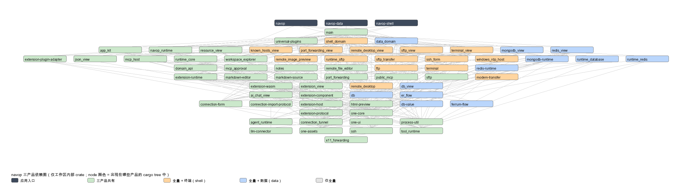

# navop 三产品依赖图



只统计**工作区内部 crate**（外部 crates.io / git 依赖略去），节点颜色表示该 crate 出现在哪些
产品的 `cargo tree` 里：

| 颜色 | 含义 | 数量 |
|---|---|---|
| 深灰 | 应用入口（`navop` / `navop-shell` / `navop-data`） | 3 |
| 绿 | 三产品共有（公共壳、共享 UI、扩展、AI、笔记、账户相关） | 39 |
| 橙 | 全量 + 终端产品（`navop-shell`） | 15 |
| 蓝 | 全量 + 数据产品（`navop-data`） | 12 |

## 各产品规模

| 产品 | feature | 工作区内部 crate | 全部包数（去重） | debug 二进制 |
|---|---|---|---|---|
| `navop`（全量） | `database` + `shell` | 66 | 867 | 916 MB |
| `navop-shell` | 仅 `shell` | 55 | 795 | 789 MB |
| `navop-data` | 仅 `database` | 52 | 841 | 875 MB |

## 终端领域（仅全量 + shell）

```
shell_domain, terminal, terminal_view, sftp_view, ssh_form, ftp, known_hosts_view,
port_forwarding_view, remote_desktop, remote_desktop_view, runtime_sftp, sftp_transfer,
remote_image_preview, modem-transfer, windows_rdp_host
```

## 数据库领域（仅全量 + data）

```
data_domain, db, db-value, db_view, er_flow, ferrum-flow, mongodb_view, mongodb-runtime,
redis_view, redis-runtime, runtime_database, runtime_redis
```

## 边界

- `ssh` 与 `sftp`、`connection_tunnel` 三产品共有：数据库连接的 SSH 隧道（`connection_tunnel`
  → `ssh`）需要它们，属于数据库产品的合法后端依赖；终端/SFTP UI crate（`terminal_view`
  / `sftp_view` / `ssh_form`）只在全量 + shell 中出现。
- `main`（公共应用壳）三产品共有，但领域代码用 `#[cfg(feature = "database")]` /
  `#[cfg(feature = "shell")]` 排除，独立产品的依赖树中不再出现对方领域的任何 crate。

## 重新生成

```bash
python3 script/product-dependency-graph.py   # 需要 Pillow，输出 docs/design/navop-product-dependency-graph.png
```
